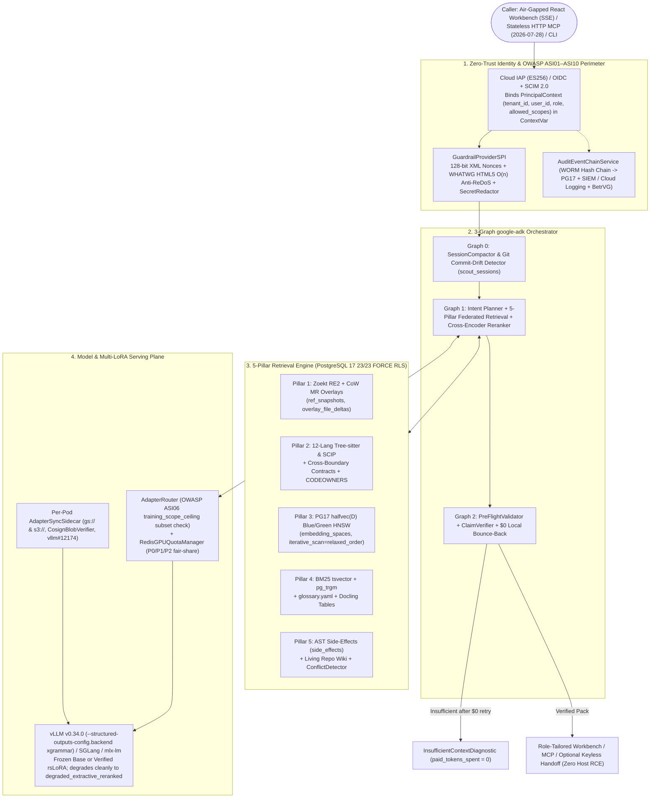
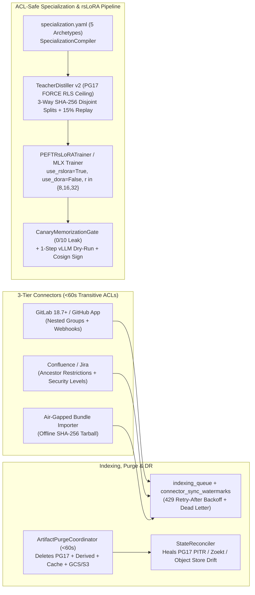

# Enterprise Context Scout (`v1.0.1`)
## Principal Architecture Blueprint, Trade-Off Defense & Implementation Specification

**Project Repository:** `enterprise-context-scout`  
**Release Version:** `1.0.1` (Apache-2.0)  
**Last Updated:** 2026-11-28  
**Deployment Model:** 100% self-hosted, cloud- and model-agnostic Enterprise Context Control Plane for private VPCs and air-gapped Kubernetes clusters  
**Default Model Stack (`$0` API Cost) + Governed BYO Open-Weights:** `google/gemma-4-26B-A4B-it` (`mlx-community/gemma-4-26b-a4b-it-4bit` on Apple Silicon), `google/embeddinggemma-2`, `google/shieldgemma-2-2b-it` as defaults, plus governed enterprise BYO open-weights (`Qwen3`/`Qwen3-Coder`, `Mistral`/`Devstral`, `DeepSeek-V3`/`R1`, `Llama 4`, `Phi-4`, `IBM Granite`, `BAAI/bge-m3`) via `vLLM`/`SGLang`/`mlx-lm`  
**Core Runtime Stack:** Python `3.12+`, FastAPI + SSE, `google-adk`, stateless Streamable HTTP MCP (`2026-07-28`), PostgreSQL 17 (`23/23` tables `FORCE ROW LEVEL SECURITY` + `pgvector` `halfvec(D)` + `pg_trgm` + FTS), Zoekt RE2, Redis, Air-Gapped React/TypeScript Workbench (`web-ui/`).

---

## 1. Executive Thesis & System Problem

When engineering, platform, and compliance teams connect frontier LLMs or naive vector RAG pipelines directly to multi-repository codebases and enterprise wikis, four structural failure modes emerge:

1. **Exploratory Token Burn (75–92% Waste):** Multi-turn cloud agent loops burn most billed input tokens scanning directories, reading unrelated files, and tracing imports—and still bill full rates when indexed knowledge does not contain the answer.
2. **"Half-Information" Code Hallucinations:** Uniform 500-token chunking severs functions from imported types, cross-service API/SQL contracts, callers, and test fixtures, and breaks on symbol renames or unmerged MR/PR diffs.
3. **Cross-Tenant & Cross-ACL Leakage:** Prompt-level RBAC and shared vector/LoRA stores leak restricted repositories, Confluence subtrees, and memorized training examples across organizational boundaries.
4. **Cloud & Model Vendor Lock-In:** Coupling core retrieval, embedding dimensions, or serving adapters to a single commercial provider prevents deployment in regulated private VPCs or air-gapped Kubernetes environments.

### Solution: Zero-Trust Enterprise Context Control Plane

Enterprise Context Scout decouples **local `$0` context discovery, ACL enforcement, and deterministic verification** from **optional downstream execution or IDE handoff**:

| Architectural Layer | Default Stack (`$0` Self-Hosted) | Governed BYO / Enterprise Alternatives |
|---|---|---|
| **Local / VPC Scout Inference** | `google/gemma-4-26B-A4B-it` (MoE, `3.8B` active) via `vLLM`/`SGLang` or 4-bit `mlx-lm` | `Qwen3`/`Qwen3-Coder`, `Mistral`/`Devstral`, `DeepSeek-V3`/`R1`, `Llama 4`, `Phi-4`, `IBM Granite` (`config/model_registry.yaml`) |
| **Embeddings (Blue/Green `halfvec(D)`)** | `google/embeddinggemma-2` (`768d`) | `BAAI/bge-m3` (`1024d`), `Qwen3-Embedding` (`1024d`/`2560d`), Vertex AI embeddings via zero-downtime `embedding_spaces` |
| **Input & Content Guardrails** | Deterministic WHATWG HTML5 $O(n)$ + `SecretRedactor` + `google/shieldgemma-2-2b-it` | Google Cloud Model Armor, `Prompt-Guard-2`, `Qwen3Guard`, `Granite-Guardian` via `GuardrailProviderSPI` |
| **Storage Kernel & ACL Isolation** | PostgreSQL 17 (`23/23` `FORCE RLS`, `NOBYPASSRLS`) + Zoekt RE2 + Redis | Cloud SQL PG17 (Private Service Connect + IAM Auth) / AlloyDB + Memorystore + CMEK GCS (`gs://`) or S3 (`s3://`) |
| **Zero-Trust Edge & Health** | Nginx air-gapped SPA proxy (`proxy_pass $scout_api_upstream;` for `/api/`, `/mcp/`, `/.well-known/*`) | Split `/api/v1/health/live` + `/api/v1/health/ready`, Cloud IAP (`ES256`), Cloud Armor WAF |
| **Optional Cloud Handoff** | Disabled by default (`allow_external_cloud_egress: false`) | Opt-in keyless Vertex AI ADC (`vertexai=True`) with YAML-governed tiers (`gemini-4-hydrogen`, `gemini-4-neon`, `gemini-4-carbon`, `config/model_pricing.yaml`) or approved IDE/MCP export—never host RCE (`OWASP ASI05`) |

---

## 2. System Topology

### 2.1 Runtime Request, 3-Graph Orchestration & Multi-LoRA Topology



### 2.2 Connector Sync, Distillation & Release Safety Topology



---

## 3. PostgreSQL 17 Schema (`23/23` Tables, Alembic `0001`–`0024`)

All database DDL is managed via Alembic (`src/context_scout/db/migrations/versions/0001_legacy_baseline.py` through `0024_m5_scim_indexes_and_connector_rls.py`, head `0024_m5_scim_idx_conn_rls`), linted with `squawk --pg-version=17.0` (`0` lock-safety violations across all `23` forward revisions `0002`–`0024`), and verified against live `pg_class`/`pg_roles` catalogs by `.agents/skills/rls-pgtap-audit/scripts/check_rls_catalog.py`.

### 3.1 Complete 23-Table Inventory (`ENABLE` + `FORCE ROW LEVEL SECURITY`)

| Domain Group | Tables (`tenant_id UUID NOT NULL` + `FORCE RLS` on 23/23) | Alembic Origin |
|---|---|---|
| **Domain & Model Registry (3)** | `domain_packs`, `domain_sync_manifests`, `model_artifacts` | `0001`, `0002`, `0018`–`0020` |
| **Code Graph & Overlays (7)** | `repositories`, `repo_commits`, `code_files`, `ast_symbols`, `ast_edges`, `ref_snapshots`, `overlay_file_deltas` | `0001`, `0007`–`0010` |
| **Side-Effects & Vectors (2)** | `side_effects`, `embedding_spaces` | `0002`, `0011`–`0014` |
| **Enterprise Docs & Trackers (3)** | `doc_chunks`, `confluence_pages`, `jira_issues` | `0001` |
| **Sync & Worker Queues (3)** | `indexing_queue`, `indexing_dead_letter`, `connector_sync_watermarks` | `0001`, `0011`–`0014`, `0024` |
| **Sessions & Telemetry (2)** | `scout_sessions`, `execution_telemetry` | `0001`, `0015`–`0017` |
| **Zero-Trust Audit & SCIM (3)** | `audit_events` (WORM hash-chained), `scim_users`, `scim_groups` | `0021`–`0024` |

### 3.2 Kernel Security Invariants (No Hardcoded Passwords)

- **Least-Privilege Runtime Role (`scout_app_user`):** Provisioned with `NOSUPERUSER NOCREATEDB NOCREATEROLE NOBYPASSRLS NOINHERIT`. In production (GKE/Cloud SQL), authentication uses keyless `CLOUD_IAM_SERVICE_ACCOUNT` (`autoIamAuthn: true`); in local/Docker development, credentials are injected strictly via environment variables (`SCOUT_DB_APP_URL` / `SCOUT_APP_ROLE_PASSWORD`)—never committed or hardcoded in SQL migrations.
- **Isolated Connection Pools (`src/context_scout/db/session.py`):** `RLSConnectionManager` maintains separate `query_pool` (strict short `statement_timeout`) and `ingestion_pool` instances, both connecting strictly as `scout_app_user`. Runtime routes and distillation jobs never access `db_admin_url`.
- **Fail-Closed Per-Transaction Binding:**
  ```sql
  SELECT set_config('app.tenant_id', $1, true);
  SELECT set_config('app.principal_scopes', $2, true);
  SET LOCAL hnsw.iterative_scan = 'relaxed_order';
  ```
  If `app.tenant_id` or `app.principal_scopes` is unset or empty, `NULLIF(current_setting(..., true), '')` evaluates to `NULL` and RLS returns `0` rows.

---

## 4. Core Pydantic v2 Contracts (`src/context_scout/schemas/contracts.py`)

Core contracts are 100% domain-neutral (`FINANCE_PLUGIN_ALLOWLIST == frozenset()`). Domain-specific examples (such as quantitative trading dogfooding) are strictly isolated under `examples/quant_dogfood/`.

```python
class RoleType(StrEnum):
    ENGINEER = "engineer"
    PRODUCT_MANAGER = "product_manager"
    COMPLIANCE_OFFICER = "compliance_officer"
    DOMAIN_RESEARCHER = "domain_researcher"


class PrincipalContext(BaseModel):
    user_id: str
    role: RoleType
    allowed_scopes: list[str] = Field(min_length=1)
    tenant_id: UUID = DEFAULT_TENANT_ID
    max_session_paid_tokens: int = Field(default=16_000, ge=1_000, le=100_000)


class CodeSlicePointer(BaseModel):
    repo_name: str
    file_path: str
    start_line: int = Field(ge=1)
    end_line: int = Field(ge=1)
    qualified_symbol: str
    selection_reason: str
    modification_intent: ModificationIntent


class VerbatimCodeSlice(CodeSlicePointer):
    git_commit_sha: str
    git_blob_sha: str
    verbatim_code_with_lines: str
    auto_expanded_by_ast: bool = False


class DocCitationSpan(BaseModel):
    chunk_id: str
    doc_id: str
    doc_title: str
    source_uri: str
    section_heading: str
    verbatim_quote: str
    full_section_content: str | None = None
```

---

## 5. 5-Pillar Retrieval & 3-Graph Orchestration Details

### 5.1 Normalized RRF Fusion & Cross-Encoder Reranking
Candidate results from Zoekt RE2 / `pg_trgm`, BM25 `tsvector` (+ `glossary.yaml` expansion), and `halfvec(D)` dense search are fused via **Normalized Reciprocal Rank Fusion**:
$$\text{RRF}_{\text{raw}}(s) = \sum_{m=1}^{M} \frac{1}{60 + \text{rank}_m(s)}, \quad \text{RRF}_{\text{norm}}(s) = \frac{\text{RRF}_{\text{raw}}(s)}{M / 61} \in [0.0, 1.0]$$
Cross-encoder reranking applies recency/version-supersession penalties (ensuring canonical `v3` runbooks outrank archived pages), demotes boilerplate/noise chunks, and feeds `ConflictDetector` to flag code-vs-stale-RFC discrepancies.

### 5.2 12-Language AST/SCIP & Pillar-5 Side-Effects
- `ASTExtractor` (`src/context_scout/ast_engine/`) runs Tree-sitter and SCIP indexers across 12 languages with fail-closed syntax-error abstention on Tree-sitter grammars, explicit `low_confidence_fallback` tagging on regex fallbacks, iterative single-pass HCL parsing (`<250 ms` on 100 KB inputs even under heavy GC pressure), and `CrossBoundaryContractLinker` edges (HTTP routes, DTOs, SQL tables, Terraform resources).
- `ASTDependencyExpander` attaches 1-hop and 2-hop `USES_TYPE` / `INHERITS` / `IMPORTS` definitions, up to `8` diverse `CALLS` callers, and matching `TESTED_BY` tests within a `10,000`-token expansion cap, sliced byte-for-byte by `DeterministicSlicer`.
- Pillar 5 indexes AST side effects (`side_effects`: database mutations, external HTTP calls, message queue publishes, lock operations) and living repo wiki summaries.

### 5.3 3-Graph `google-adk` Orchestrator & Deterministic Pre-Flight Gate
1. **Graph 0 (`SessionCompactor`):** Compacts multi-turn session history persisted in `scout_sessions` under `FORCE RLS` and invalidates stale slices when `git_commit_sha` drifts.
2. **Graph 1 (Federated Retrieval & Synthesis):** Probes authorized `domains/<id>/domain.yaml` packs, executes 5-pillar retrieval, routes via `AdapterRouter` (`OWASP ASI06`), and synthesizes structured pointers/briefs with `sufficiency_verdict` and per-facet grounding.
3. **Graph 2 (`PreFlightValidator` & `ClaimVerifier`):** Deterministically checks AST symbol resolution, prompt identifier partitioning, Normalized RRF threshold (`>= 0.55` / `0.65` or cross-encoder `>= 0.60`), NFKC verbatim citation overlap (`>= 0.98`, fail-closed on missing `chunk_id`), freshness, and facet coverage. Failed drafts trigger `1` local `$0` bounce-back retry; unresolved drafts terminate cleanly with `InsufficientContextDiagnostic(paid_tokens_spent=0)`.

---

## 6. BYO Open-Weights Governance, 5-Archetype Specialization & Multi-LoRA Safety

1. **Supply-Chain Policy (`config/model_registry.yaml`, `ModelGovernancePolicy`):** `.safetensors`-only weights, `trust_remote_code=False`, SPDX license allowlist, `allow_external_cloud_egress=False` by default, CycloneDX `1.6` AI-BOM (`scripts/generate_aibom.py`), and Sigstore EC P-256 `CosignBlobVerifier`.
2. **Declarative Domain Packs (`domains/`):** Four shipped domain-neutral packs (`code_architecture_scout`, `data_engineering_scout`, `enterprise_docs_scout`, `polyglot_unseen_v2`) plus `custom_json_contract` archetype compiled by `SpecializationCompiler` from `domain.yaml`, `specialization.yaml`, `glossary.yaml`, and `schema.json`.
3. **ACL-Safe `rsLoRA` Invariants (`OWASP ASI06` & `vllm#12174`):**
   - `use_rslora=True`, `use_dora=False`, `rank in {8, 16, 32}`, `assistant_only_loss=True`, frozen MoE router gates & Mamba SSM states.
   - Ceiling-bounded `TeacherDistiller` v2 against live PG17 `FORCE RLS`, 3-way SHA-256 disjoint `train`/`valid`/`eval` splits (with holdout module-group isolation), `15%` general replay buffer, and `CanaryMemorizationGate` (`0/10` canary extraction).
   - `AdapterRouter` routes to a LoRA cartridge **only** when `set(training_scope_ceiling).issubset(set(principal.allowed_scopes))` within the matching `tenant_id`; otherwise routes strictly to the frozen base model (`lora_request=None`).
   - Per-pod `AdapterSyncSidecar` verifies SHA-256 digests and Cosign bundles from `gs://` or `s3://` and manages atomic vLLM multi-LoRA load/unload/rollback.

---

## 7. Security Model (`OWASP ASI01`–`ASI10`) & Zero Host RCE

Detailed control-by-control documentation lives in [`docs/SECURITY_AND_GOVERNANCE.md`](docs/SECURITY_AND_GOVERNANCE.md) and verified test evidence lives in [`reports/v1_ga_release_scorecard.md`](reports/v1_ga_release_scorecard.md):

- **ASI01 (Prompt Hijack):** Per-request 128-bit random XML nonces, single-pass $O(n)$ anti-ReDoS + 11-state WHATWG HTML5 scanner, NFKC/homoglyph folding, Base64/URI-entity decoding, `SecretRedactor`.
- **ASI02 (Tool Misuse):** Stateless Streamable HTTP MCP (`2026-07-28`), forbidden identity argument rejection, path traversal blocking, SQL `ILIKE` escaping, client score stripping.
- **ASI03 (Privilege Abuse):** Cloud IAP (`ES256`) / OIDC JWTs, untrusted tenant header rejection (`403`), recursive RBAC checks, PG17 `23/23` `FORCE RLS`.
- **ASI04 (Supply Chain):** `.safetensors`-only, `trust_remote_code=False`, Cosign verification, CycloneDX `1.6` AI-BOM.
- **ASI05 (Zero Host Code Execution):** `0` `shell=True` calls in `src/context_scout/`; `POST /api/v1/handoff/apply` rejects `custom_patch` (`HTTP 400`); host-side `pytest` invocation and arbitrary host repository patching are strictly prohibited.
- **ASI06 (Memory/Context Poisoning):** `AdapterRouter` `training_scope_ceiling` subset routing, `0/10` `CanaryMemorizationGate`, zero domain lock-in.
- **ASI07 (Insecure Comms):** Fail-closed HMAC-SHA256 webhooks with replay-ID protection and SSRF-hardened `WebhookSIEMExporter`.
- **ASI08 (Cascading Failures):** `RedisGPUQuotaManager` (`P0`/`P1`/`P2` preemption), `degraded_extractive_reranked` fallback, PITR `StateReconciler`, `ContextVar` isolation.
- **ASI09 (Trust Exploitation):** `/handoff/preview` requires `preflight_report.passed` + `100%` citation verification; `/handoff/apply` requires atomic single-consume tenant+user confirmation token + `confirmed=True`.
- **ASI10 (Rogue Agents & Governance):** WORM hash-chained `audit_events`, `SessionBudgetTracker` kill switch, `<60s` `ArtifactPurgeCoordinator`, EU BetrVG privacy anonymization.

---

## 8. Repository Layout & CI/CD

```text
enterprise-context-scout/
├── .github/workflows/ci.yml            # GitHub Actions CI (ruff, mypy --strict, PG17 pytest, web-ui)
├── config/model_registry.yaml          # Governed $0 Gemma 4 defaults + BYO open-weights catalog
├── deploy/
│   ├── docker/                         # Distroless Python images (api, worker, sidecar) & Alpine webui
│   ├── helm/context-scout/             # Helm chart + values-gcp-gke.yaml (WIF, PSC, IAP, Cloud Armor)
│   ├── terraform/                      # gcp-gke, aws-eks, azure-aks, onprem-k8s IaC overlays
│   └── airgap/                         # Air-gapped bundle packager
├── domains/                            # 4 domain-neutral DomainPacks (code, data eng, enterprise docs, polyglot)
├── examples/quant_dogfood/             # Isolated finance dogfooding example (zero core coupling)
├── reports/v1_ga_release_scorecard.md  # Authoritative v1.0.1 L1–L12 release verification scorecard
├── scripts/generate_aibom.py           # 544-component CycloneDX 1.6 AI-BOM + Sigstore Cosign signing
├── scripts/smoke_e2e_live_stack.py     # 4-image Docker + live Nginx->Uvicorn->Redis->PG17 E2E smoke
├── src/context_scout/
│   ├── agents/                         # 3-graph ADK workflow, PreFlightValidator, ClaimVerifier, vLLM v0.34/MLX
│   ├── api/                            # FastAPI SSE, IAP/OIDC/SCIM, stateless MCP HTTP, /health/{live,ready}
│   ├── ast_engine/                     # 12-lang Tree-sitter/SCIP (PEP 562 lazy package exports), slicer
│   ├── connectors/                     # GitLab 18.7+, GitHub App, Confluence, Jira, air-gap bundle, 3-tier sync
│   ├── db/                             # Alembic migrations 0001–0024, RLSConnectionManager, PG17 repositories
│   ├── evals/                          # Retrieval, citation faithfulness, RBAC, and wiki-scale harnesses
│   ├── ops/                            # ArtifactPurgeCoordinator (<60s) & PITR StateReconciler
│   ├── schemas/                        # Domain-neutral Pydantic v2 contracts
│   ├── security/                       # OWASP ASI01–ASI10 guardrails, RBAC, IAP/OIDC, WORM audit, mutation gate
│   ├── serving/                        # Pruned per-pod AdapterSyncSidecar (gs:// & s3://)
│   ├── storage/                        # Keyless GCS (ADC/WIF) & S3 object stores
│   └── tuning/                         # SpecializationCompiler, TeacherDistiller v2, PEFTRsLoRATrainer, CanaryGate
├── tests/                              # 85 zero-skip Python suites (PG17 FORCE RLS, OWASP, Schemathesis, L9)
└── web-ui/                             # Air-gapped strict TypeScript + React Workbench (11 Vitest suites / 83 tests, WCAG 2.2 AA)
```
