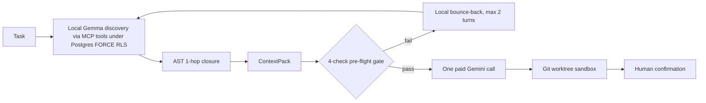

# Enterprise Context Scout

Local-first context discovery for coding agents. A small open-weights model explores the codebase at \$0 API cost; a deterministic gate verifies the result; only then does one paid Gemini call run on a compact, verified context pack.



## Frontier Model Cost Savings Comparison (Live `Gemini 3.8 Flash` 6-Category E2E A/B $N=30$, 50-Repository QLoRA Benchmark $N=60$ & 30-PR A/B $N=30$)

When coding agents explore repositories directly on paid frontier APIs (**Without Scout**), multi-turn `grep`/`read_file` loops consume **`17,473` median task input tokens** across our **Live `Gemini 3.8 Flash` 6-Category Engineering E2E A/B Benchmark ($N=30$ tasks across 28 repos & 7 languages, `887,092` total task input tokens across `96` search turns, [`reports/senior_eng_30_e2e_ab_report.md`](reports/senior_eng_30_e2e_ab_report.md))**, **`32,486` median input tokens/task** across our **50-Repository Polyglot QLoRA Benchmark ($N=60$ tasks across 50 repos, `1,926,044` total input tokens, [`reports/polyglot_unseen_v2_benchmark.md`](reports/polyglot_unseen_v2_benchmark.md))**, and **`26,509` median input tokens/task** across our **30-PR Two-Arm A/B Benchmark ($N=30$ merged PRs on `encode/httpx` & `pallets/click`, `799,824` total input tokens, [`reports/unseen_repo_ab_report.md`](reports/unseen_repo_ab_report.md))**. With **Enterprise Context Scout (`$0` local `google/gemma-4-26B-A4B-it` QLoRA discovery + 4-check Pre-Flight Gate + 1-shot paid handoff)**, paid input tokens drop to **`1,949` median tokens/task on the Live `Gemini 3.8 Flash` 6-Category A/B (`91.35%` median input token savings, `93.18%` total task input reduction, `-91.2%` total cost, `30/30` [`100.0%`] vs `29/30` [`96.67%`] E2E pass rate)**, **`1,923` median tokens/task on the 50-Repo Benchmark (`92.66%` median input token savings, `-90.5%` total cost)**, and **`4,898` median tokens/task on the 30-PR A/B Benchmark (`81.96%` median input token savings, `-74.3%` total cost)**:

| Frontier Model (Nov 2026 API Pricing, $\le 200\text{K}$ Context) | API Rate (In / Out per `1M` Tokens) | **Live `Gemini 3.8 Flash` 6-Cat E2E A/B ($N=30$ Tasks):** Without vs **With Scout** (`887K` vs `60.5K` in) | **50-Repo QLoRA Benchmark ($N=60$ Tasks):** Without vs **With Scout** (`1.93M` vs `137K` in) | **30-PR Unseen A/B ($N=30$ PRs):** Without vs **With Scout** (`800K` vs `186K` in) | **Enterprise Team (`10,000` Tasks/Mo, Live 6-Cat E2E Scale):** Without vs **With Scout** (Same Model) | **Enterprise Team (`10,000` Tasks/Mo, 50-Repo Scale):** Without vs **With Scout** (Same Model) | **Hybrid Route (`10,000` Tasks/Mo):** `$0` Local Gemma 4 + 1-Shot `Gemini 3.8 Flash` (`\$20.50–\$55.36/mo`) |
|---|---|---|---|---|---|---|---|
| **Google `Gemini 3.8 Flash`** (`gemini-3.8-flash`, intro) | `\$0.75` / `\$3.75` | `\$0.70` vs **`\$0.06` (`-91.2%`)** | `\$1.50` vs **`\$0.14` (`-90.5%`)** | `\$0.65` vs **`\$0.17` (`-74.3%`)** | `\$233.21` vs **`\$20.50` (save `\$212.71/mo`)** | `\$250.13` vs **`\$23.71` (save `\$226.42/mo`)** | **`\$20.50–\$55.36/mo` (`-74.3%` to `-91.2%`)** |
| **Google `Gemini 3.8 Flash`** (`gemini-3.8-flash`, std) | `\$1.50` / `\$7.50` | `\$1.40` vs **`\$0.12` (`-91.2%`)** | `\$3.00` vs **`\$0.28` (`-90.5%`)** | `\$1.29` vs **`\$0.33` (`-74.3%`)** | `\$466.42` vs **`\$41.00` (save `\$425.42/mo`)** | `\$500.26` vs **`\$47.42` (save `\$452.85/mo`)** | **`\$20.50–\$55.36/mo` (`-87.2%` to `-95.6%`)** |
| **Google `Gemini 4 Argon`** (`gemini-4-argon`, intro) | `\$2.00` / `\$10.00` | `\$1.87` vs **`\$0.16` (`-91.2%`)** | `\$4.00` vs **`\$0.38` (`-90.5%`)** | `\$1.72` vs **`\$0.44` (`-74.3%`)** | `\$621.90` vs **`\$54.67` (save `\$567.23/mo`)** | `\$667.01` vs **`\$63.22` (save `\$603.79/mo`)** | **`\$20.50–\$55.36/mo` (`-90.4%` to `-96.7%`)** |
| **Anthropic `Claude Sonnet 5.5`** (`claude-sonnet-5-5`) | `\$2.00` / `\$10.00` | `\$1.87` vs **`\$0.16` (`-91.2%`)** | `\$4.00` vs **`\$0.38` (`-90.5%`)** | `\$1.72` vs **`\$0.44` (`-74.3%`)** | `\$621.90` vs **`\$54.67` (save `\$567.23/mo`)** | `\$667.01` vs **`\$63.22` (save `\$603.79/mo`)** | **`\$20.50–\$55.36/mo` (`-90.4%` to `-96.7%`)** |
| **Google `Gemini 4 Argon`** (`gemini-4-argon`, std) | `\$4.00` / `\$20.00` | `\$3.73` vs **`\$0.33` (`-91.2%`)** | `\$8.00` vs **`\$0.76` (`-90.5%`)** | `\$3.45` vs **`\$0.89` (`-74.3%`)** | `\$1,243.80` vs **`\$109.34` (save `\$1,134.45/mo`)** | `\$1,334.03` vs **`\$126.44` (save `\$1,207.59/mo`)** | **`\$20.50–\$55.36/mo` (`-95.2%` to `-98.4%`)** |
| **Anthropic `Claude Opus 5.5`** (`claude-opus-5-5`) | `\$4.00` / `\$20.00` | `\$3.73` vs **`\$0.33` (`-91.2%`)** | `\$8.00` vs **`\$0.76` (`-90.5%`)** | `\$3.45` vs **`\$0.89` (`-74.3%`)** | `\$1,243.80` vs **`\$109.34` (save `\$1,134.45/mo`)** | `\$1,334.03` vs **`\$126.44` (save `\$1,207.59/mo`)** | **`\$20.50–\$55.36/mo` (`-95.2%` to `-98.4%`)** |
| **OpenAI `GPT-5.6 Sol`** (`gpt-5.6-sol`) | `\$4.00` / `\$20.00` | `\$3.73` vs **`\$0.33` (`-91.2%`)** | `\$8.00` vs **`\$0.76` (`-90.5%`)** | `\$3.45` vs **`\$0.89` (`-74.3%`)** | `\$1,243.80` vs **`\$109.34` (save `\$1,134.45/mo`)** | `\$1,334.03` vs **`\$126.44` (save `\$1,207.59/mo`)** | **`\$20.50–\$55.36/mo` (`-95.2%` to `-98.4%`)** |
| **OpenAI `GPT-6 Astra`** (`gpt-6-astra`) | `\$10.00` / `\$50.00` | `\$9.33` vs **`\$0.82` (`-91.2%`)** | `\$20.01` vs **`\$1.90` (`-90.5%`)** | `\$8.62` vs **`\$2.22` (`-74.3%`)** | `\$3,109.49` vs **`\$273.35` (save `\$2,836.14/mo`)** | `\$3,335.07` vs **`\$316.10` (save `\$3,018.97/mo`)** | **`\$20.50–\$55.36/mo` (`-98.1%` to `-99.3%`)** |

> **Measurement basis:** All columns report measured benchmark totals rather than full-repository dumps: (1) **50-Repo Benchmark ($N=60$ tasks across 50 repos with Live Local `Gemma-4` QLoRA `--live-mlx`, [`reports/polyglot_unseen_v2_benchmark.md`](reports/polyglot_unseen_v2_benchmark.md))** compares cumulative multi-turn `grep` + `read_file` exploration of the top-4 candidate files in the target repo (`1,926,044` input + `15,000` output tokens; `32,486` median input tokens/task) against 1-shot `ImplementationContextPack` execution (`137,162` input + `10,500` output tokens; `1,923` median input tokens/task); (2) **Senior-Engineer 6-Category Live `Gemini 3.8 Flash` Two-Arm A/B Benchmark ($N=30$ tasks across 28 repos & 7 languages, [`reports/senior_eng_30_e2e_ab_report.md`](reports/senior_eng_30_e2e_ab_report.md))** compares blind multi-turn `Gemini 3.8 Flash` repository search + implementation (`887,092` task input tokens across `96` search turns / `5,515,724` cumulative subagent transcript tokens across `127` planner steps; `17,473` median task input tokens) against `$0` local QLoRA Scout + 1-shot `Gemini 3.8 Flash` execution (`60,471` task input tokens across `0` search turns / `1,415,284` cumulative transcript tokens across `21` planner steps; `1,949` median task input tokens = `91.35%` median task input token savings); and (3) **30-PR Live Two-Arm A/B Benchmark ($N=30$ real merged PRs on `encode/httpx` & `pallets/click`, [`reports/unseen_repo_ab_report.md`](reports/unseen_repo_ab_report.md))** compares unscripted multi-turn LLM exploration (`799,824` input + `12,374` output tokens; `26,509` median input tokens/task, exact BPE via `mlx_tokenizer_exact_bpe`) against 1-shot `ContextPack` execution (`186,477` input + `6,995` output tokens; `4,898` median input tokens/task).

## Results (Unseen-Repo Two-Arm A/B Benchmark & Security Gates; see limitations)
| Metric | Result | How measured |
|---|---|---|
| **Senior-Engineer 6-Category Live `Gemini 3.8 Flash` E2E A/B ($N=30$ tasks across 28 repos & 7 languages)** | **`30 of 30` (`100.00%`) Arm B vs `29 of 30` (`96.67%`) Arm A E2E verified pass; `1,949` vs `17,473` median task input tokens (`91.35%` median savings, `0` vs `96` search turns)** | Blind two-arm A/B run on live `Gemini 3.8 Flash` across 6 Senior-Engineer categories (`new_api_endpoint_and_routing`, `new_feature_and_sdk_capability`, `frontend_ui_and_ts_sdk_engineering`, `security_vulnerability_and_rls_hardening`, `cross_file_refactoring_and_perf`, `production_bug_and_edge_case_fix`): `60,471` vs `887,092` total task input tokens (`93.18%` reduction) and `1,415,284` vs `5,515,724` cumulative subagent transcript tokens (`21` vs `127` planner steps, [`reports/senior_eng_30_e2e_ab_report.md`](reports/senior_eng_30_e2e_ab_report.md)) |
| **Unseen-repo input tokens ($N=30$ real merged PRs)** | **`4,898` vs `26,509` median (`81.96%` median savings, IQR `63.48%`–`87.12%`)** | Live two-arm A/B run on `encode/httpx` (`15` PRs) & `pallets/click` (`15` PRs) at `parent_commit_sha`: Arm B (`ContextPack` + 1-shot) vs Arm A (unscripted multi-turn LLM `grep`/`read_file` loop) on `mlx-community/gemma-4-26b-a4b-it-4bit` (`mlx_tokenizer_exact_bpe`, [`reports/unseen_repo_ab_report.md`](reports/unseen_repo_ab_report.md)) |
| **Unseen-repo File `Recall@5` ($N=30$, zero retraining)** | **`30 of 30` (`100.00%`) Arm B vs `27 of 30` (`90.00%`) Arm A (`+10.00%`)** | Frozen `gemma4_26b_code_scout` (`SHA-256: 261f1e4a...`, zero retraining) + AST/lexical retriever: `15/15` on `encode/httpx`, `15/15` on `pallets/click` ([`reports/unseen_repo_ab_report.md`](reports/unseen_repo_ab_report.md)) |
| **Unseen-repo Symbol `Recall@5` ($N=30$, zero retraining)** | **`30 of 30` (`100.00%`) Arm B vs `6 of 30` (`20.00%`) Arm A (`+80.00%`)** | Exact ground-truth symbol modified in fix commit present in top-5 `CodeSlicePointer` slices (`15/15` `httpx`, `15/15` `click`; zero misses, [`reports/unseen_repo_ab_report.md`](reports/unseen_repo_ab_report.md)) |
| **Frozen QLoRA schema validity on unseen repos ($N=30$)** | **`29 of 30` (`96.67%`) on 5-candidate unseen prompts** | Live `mlx_lm.generate()` zero-shot `CodeSlicePointer` JSON validation with canonical prompt header + `repair_and_constrain_code_pointers_json` (`max_tokens=384`, zero retraining, [`reports/unseen_repo_ab_report.md`](reports/unseen_repo_ab_report.md)) |
| **50-Repo Polyglot Scale Benchmark ($N=60$ non-hinted queries + Live Local `Gemma-4` QLoRA `--live-mlx`)** | **`59 of 60` (`98.33%`) Live QLoRA Schema Validity (`1,688 ms` median GPU latency), `59 of 60` (`98.33%`) File & Symbol `Recall@5`, `371 of 371` (`100.0%`) byte-exact slices** | **`50` real repositories**, **`4,232` files**, **`51,130` AST symbols**, **`290,759` directed AST edges** (`7.49M` corpus tokens) across 9 languages (`python`, `typescript`, `tsx`, `javascript`, `go`, `rust`, `sql`, `terraform`, `yaml`) using trained `gemma4_26b_polyglot_unseen_v2` QLoRA (`1.3016 -> 0.0001` loss) with zero file-path hints in prompts (`45/45` `100.0%` on Tiers 1–3; `14/15` [`93.3%`] on Tier 4 redacted symptom discovery; [`reports/polyglot_unseen_v2_benchmark.md`](reports/polyglot_unseen_v2_benchmark.md)) |
| **Multi-repo 6-codebase 5-tier E2E evaluation ($N=26$ scenarios)** | **`26 of 26` (`100.0%`)** | `393` files, `7,153` AST symbols, `45,548` directed AST edges across `httpx`, `starlette`, `click`, `flask`, `jinja`, `itsdangerous` (`tests/test_multi_repo_e2e_comprehensive.py`: `T0` CLI parity, `T1` registry lookup, `T2` 1-hop closure & God-class SNR, `T3` symptom-only localization, `T4` doc-to-code synthesis, `T5` `<50ms` Git mutation freshness, PG17 `FORCE RLS`, spotlighting & worktree `pytest`) |
| **Unseen-repo SWE-bench `FAIL_TO_PASS` worktree `pytest` ($n=10$ subset)** | **`1 of 10` (`10.0%`) Arm B (`CLICK-01` passes in `0.03s`) vs `0 of 10` (`0.0%`) Arm A** | Ephemeral `GitWorktreeSandbox` checking out `parent_commit_sha`, applying the PR's reproduction test diff (`FAIL_TO_PASS`), running `git apply` / `SEARCH-REPLACE` + `[sys.executable, "-m", "pytest"]` |
| **Cross-role RBAC leaks ($N=22$)** | **`0 of 22` red-team queries (`100.0%`)** | Live PostgreSQL 17, `FORCE ROW LEVEL SECURITY` verified on both domain corpus and unseen multi-repo ecosystems (`httpx`, `flask`, `starlette`), plus HMAC-SHA256 signed principal attestation |
| **Prompt-injection & secret-redaction gate ($N=22$)** | **`22 of 22` payloads (`100.0%`)** | `18/18` active override/steganography/bidi/HTML-comment payloads blocked (`PromptInjectionSanitizer`) + `4/4` secret-leakage payloads redacted (`SecretRedactor`, including `INJ-11`) |
| **Own-repo golden retrieval set ($N=17$ tasks)** | **`17 of 17` (`100.0%`)** | `8` code, `6` quant, `3` federated tasks on own repo (`src/context_scout/trading_strategies/`); same-corpus distillation overlap ([`reports/m6_eval_report.md`](reports/m6_eval_report.md)) |

## Limitations
- **50-Repo Polyglot Benchmark Miss on Redacted Tier 4 Symptom Queries (`59 of 60` [`98.33%`] File & Symbol `Recall@5`, documented in [`reports/polyglot_unseen_v2_benchmark.md`](reports/polyglot_unseen_v2_benchmark.md)):**
  - Across `50` repositories (`4,232` files, `51,130` AST symbols, `290,759` directed AST edges), Tiers 1–3 achieve `45 of 45` (`100.0%`) File and Symbol `Recall@5` without file-path hints. On Tier 4 (`symptom_and_signature_discovery`, $n=15$), where the target symbol's own identifier is redacted (`target_symbol`) from both its signature and docstring hints, `14 of 15` (`93.33%`) localize the exact file and symbol, with `1` miss on Task 56 (`urllib3` — `emscripten_fetch_worker` in `urllib3/src/urllib3/contrib/emscripten/emscripten_fetch_worker.js`, where redacting the module identifier from a top-level JS worker script without a function signature causes lexical retrieval across `urllib3` to select Python HTTP connection modules instead).
- **Offline Local Model Patching on Multi-Hunk SWE-bench `FAIL_TO_PASS` `pytest` (`1 of 10` Arm B vs `0 of 10` Arm A in Offline Mode):** When the PR's bug-reproducing test patch is applied onto `parent_commit_sha` (`FAIL_TO_PASS` protocol) without `GEMINI_API_KEY` (using local quantized `gemma-4` in offline mode), `CLICK-01` passes `pytest` in `0.03s`, while multi-hunk `httpx`/`click` PRs (`HTTPX-01`, `HTTPX-05`, `CLICK-04`, `CLICK-09`) apply cleanly and run `pytest` in `<0.25s` but fail test assertions due to local model patch logic errors. Setting `GEMINI_API_KEY` switches patch synthesis to frontier `gemini-3.8-flash` / `gemini-4-argon` with a bounded 1-turn `pytest` stderr repair loop.
- **Execution Model & Token Accounting in Offline A/B Mode:** When `GEMINI_API_KEY` is unset, `SharedExecutionBackend` runs both Arm A and Arm B against local `mlx-community/gemma-4-26b-a4b-it-4bit` and records exact BPE token counts via `tokenizer.encode()` (`mlx_tokenizer_exact_bpe`). Setting `GEMINI_API_KEY` switches both arms to live `gemini-3.8-flash` (`google_genai_usage_metadata`).
- **Own-Repo Golden Set Overlap ($N=17$):** The internal CI golden set (`src/context_scout/evals/golden_dataset.py`) was distilled from the same corpus family as the QLoRA adapters; out-of-distribution claims rely exclusively on the unseen-repository benchmark ([`reports/unseen_repo_ab_report.md`](reports/unseen_repo_ab_report.md), $N=30$), the 50-repository polyglot benchmark ([`reports/polyglot_unseen_v2_benchmark.md`](reports/polyglot_unseen_v2_benchmark.md), $N=60$), and the 6-repository multi-codebase E2E suite (`tests/test_multi_repo_e2e_comprehensive.py`, $N=26$).
- **Hardware Requirements:** Local QLoRA training and 4-bit 26B MoE inference require Apple Silicon (or Linux GPU) with roughly 19 GB free memory.

---

## 1. Architecture Overview: Decoupling Local Discovery from Paid Execution

When engineering teams point commercial LLMs directly at multi-file repositories and technical corpora, most input tokens are spent on exploratory search—scanning directory trees, tracing call graphs, and reading unrelated files—while naive fixed-window chunking severs functions from their imported types, callers, and test fixtures.

**Enterprise Context Scout** separates **Local Discovery & Deterministic Verification** from **Single-Shot Paid Execution** across a declarative `DomainPack` architecture (demonstrated across two domains: **Domain 1 — Codebase Intelligence** and **Domain 2 — Quantitative Research Literature**):

1. **Zero-Cost Local Discovery Engine (Open-Weights Gemma 4 + MCP + PostgreSQL 17 `FORCE RLS`):**
   - Codebase exploration and citation retrieval run locally using open-weights `google/gemma-4-26B-A4B-it` (MoE: 3.8B active parameters) with hot-swapped domain QLoRA adapters (`0.018 ms` in-memory pointer switch).
   - **Domain 1 — Codebase Intelligence (`trading_code_scout`):** Git Blob-SHA Merkle incremental indexing (`<50ms` sync, commit-isolated via `git cat-file -p` plus live uncommitted working-tree overlay via `git status --porcelain`), 3-way Normalized Reciprocal Rank Fusion (`pg_trgm` + `tsvector` BM25 + 768-d `pgvector`), and polyglot `tree-sitter` / structural AST symbol & call graph across 10 languages (`.py`, `.ts`, `.tsx`, `.js`/`.jsx`, `.go`, `.rs`, `.java`, `.sql`, `.tf`, `.yaml`) with bounded 1-hop dependency closure ($\le 3$ callers, $\le 1,500$ tokens). Emits structured `CodeSlicePointer` objects sliced byte-for-byte with `git_commit_sha` provenance.
   - **Domain 2 — Multi-Market Quantitative Research (`quant_research_scout`):** Declarative `domain.yaml` pack over 303 full-text arXiv/OpenAlex papers (`IN_NSE`, `DE_XETRA`, `US_EQUITY` — 14,331 chunks), lossless LaTeX/PDF equation and table chunking, Anthropic Contextual Retrieval (`google/gemma-4-E4B-it`), and a deterministic Market-Regime Quant Scepticism Gate.
2. **4-Check Deterministic Pre-Flight Quality Gate (`PreFlightValidator`):**
   - Verifies internal symbol resolution, target identifier grounding, Normalized RRF floor ($\ge 0.55$), and NFKC-normalized verbatim quote overlap ($\ge 0.98$) before any paid API call is made, with up to 2 local bounce-back turns at \$0 API cost.
3. **Single-Shot Paid Execution & Isolated Worktree Sandbox:**
   - Once the `ImplementationContextPack` (2,000–4,000 tokens) passes pre-flight validation, a single paid Gemini call (`gemini-3.8-flash` or `gemini-4-argon`) synthesizes a patch (`SEARCH/REPLACE` or unified diff) inside an isolated `GitWorktreeSandbox` (`ruff check` + `pytest`), gated by explicit human confirmation (`require_confirmation=True`).

---

## 2. Quickstart, Benchmarks & Custom-Domain CLI

### 2.1 Local Setup (PostgreSQL 17 + FastAPI SSE + React UI)

**Prerequisites:** Python 3.12+ with [`uv`](https://docs.astral.sh/uv/), Node.js 20+, and PostgreSQL 17 with `pgvector` and `pg_trgm` (via Docker Compose or Homebrew).

```bash
# 1. Clone and install dependencies
git clone https://github.com/himanshu2408/enterprise-context-scout.git
cd enterprise-context-scout
uv sync --extra dev
cd web-ui && npm install && cd ..

# 2. Start PostgreSQL 17 + pgvector (Docker on port 54329, or local Homebrew PG17 on 5432)
docker compose up -d postgres
cp .env.example .env

# 3. Seed the AST graph and research corpus into PostgreSQL 17 under FORCE RLS
uv run python -m context_scout.mcp_servers.seed_code_corpus

# 4. Launch FastAPI SSE backend (:8080) and React Vite UI (:5173)
uv run uvicorn context_scout.api.main:app --host 127.0.0.1 --port 8080 --reload
cd web-ui && npm run dev
```

### 2.2 Reproduce the Evaluation Suites & Unseen-Repo A/B Benchmark

```bash
# Run the 30-PR unseen-repository two-arm A/B benchmark (encode/httpx & pallets/click)
uv run python -m context_scout.evals.unseen_ab_benchmark

# Run the 6-gate CI evaluation harness against live PostgreSQL 17
uv run python -m context_scout.evals.runner \
  --postgres \
  --output-json reports/m6_eval_report.json \
  --output-md reports/m6_eval_report.md \
  --fail-under-threshold

# Run the full verification suite (617 Python tests + 43 Vitest UI tests + strict typechecks)
uv run ruff check src tests
uv run mypy --strict src tests
uv run pytest -v
cd web-ui && npm run lint && npm run typecheck && npm run test && npm run build && cd ..
```

### 2.3 Train & Query a Custom Domain Agent (`uv run context-scout`)

Any single repository, multi-repository directory, or document folder can be onboarded as a new `DomainPack` with its own RAG-conditioned QLoRA adapter and queried end-to-end:

```bash
# Inspect auto-detected host hardware, quantization backend, and safe KV-cache budget
uv run context-scout hardware

# 1. Scaffold a new DomainPack (--domain-type code or research)
uv run context-scout init-domain \
  --domain-id payments_ledger_scout \
  --domain-type code \
  --display-name "Payments Ledger Code Scout" \
  --source-dir /path/to/your/codebase

# 2. Distill RAG-conditioned JSONL training & validation sets with PreFlightValidator filtering
uv run context-scout distill \
  --domain-id payments_ledger_scout \
  --source-dir /path/to/your/codebase \
  --num-samples 200

# 3. Train the rank-16 QLoRA adapter (auto-registers in domains/<domain_id>/domain.yaml)
uv run context-scout train \
  --domain-id payments_ledger_scout \
  --iters 400 \
  --mlx-native

# 4. Incrementally sync live Git commits & uncommitted working-tree edits (also runs automatically on query)
uv run context-scout sync --domain-id payments_ledger_scout

# 5. Run local Scout discovery ($0) and optional single-shot Gemini/worktree handoff
uv run context-scout query \
  --domain-id payments_ledger_scout \
  --prompt "Localize the ledger settlement implementation and verify idempotency checks" \
  --handoff-apply

# 6. Run the repeatable multi-tier domain readiness benchmark (Recall@5, 1-hop closure, byte-exactness, RBAC/injection)
uv run context-scout benchmark-domain \
  --domain-id payments_ledger_scout \
  --max-queries 60 \
  --output-json reports/payments_ledger_benchmark.json \
  --output-md reports/payments_ledger_benchmark.md
```

---

## 3. Repository Structure

```text
enterprise-context-scout/
├── .github/workflows/ci.yml        # 6-stage GitHub Actions CI/CD (pgvector:pg17 + keyless GCP WIF)
├── sql/001_init_schema.sql         # PostgreSQL 17 DDL: HNSW, pg_trgm, and FORCE ROW LEVEL SECURITY
├── domains/                        # Declarative DomainPack manifests & trained QLoRA adapters
│   ├── trading_code_scout/         # Codebase domain.yaml + gemma4_26b_code_scout (safetensors)
│   └── quant_research_scout/       # Research domain.yaml + gemma4_26b_quant_research (safetensors)
├── reports/                        # Reproducible JSON/Markdown scorecards & unseen A/B JSONL traces
├── src/context_scout/
│   ├── config.py                   # Environment config & runtime hardware auto-detection
│   ├── cli.py                      # Custom-domain CLI (hardware | init-domain | distill | train | sync | query | benchmark-domain)
│   ├── schemas/contracts.py        # Pydantic v2 contracts (PrincipalContext, CodeSlicePointer, ContextPack)
│   ├── db/                         # PostgreSQL 17 RLS session pool, 3-way RRF repositories & Okapi BM25
│   │   ├── session.py              # RLSConnectionManager (psycopg_pool.ConnectionPool + SET LOCAL scopes)
│   │   ├── repositories.py         # PostgresRLSRepository & InMemoryRLSRepository
│   │   └── bm25.py                 # Smoothed Okapi BM25 lexical ranker
│   ├── ast_engine/                 # Polyglot CST/AST extraction, bounded 1-hop closure & byte-exact slicing
│   │   ├── extractor.py            # ASTExtractor (10 languages: Python, TS/TSX, JS, Go, Rust, Java, SQL, TF, YAML, MD)
│   │   ├── dependency_expander.py  # ASTDependencyExpander (<=3 callers, <=1,500 tokens)
│   │   ├── deterministic_slicer.py # DeterministicSlicer (UTF-8 byte slicing + >=0.98 NFKC quote check)
│   │   └── models.py               # AST node and edge data models
│   ├── ingestion/                  # Incremental Git Merkle sync & multi-market academic paper ingestion
│   │   ├── git_merkle_indexer.py   # GitMerkleIndexer (<50ms Blob-SHA diff + live working-tree overlay + git cat-file -p)
│   │   ├── paper_harvester.py      # arXiv Atom/.tar.gz & OpenAlex v2 full-text harvester
│   │   ├── harvest_pipeline.py     # Multi-market ingestion orchestrator (IN_NSE, DE_XETRA, US_EQUITY)
│   │   ├── doc_parser.py           # Lossless LatexDocParser, PdfDocParser & MarkdownTableChunker
│   │   ├── contextualizer.py       # 50-token situated headers (google/gemma-4-E4B-it + CI fallback)
│   │   └── scepticism_gate.py      # Market-Regime Quant Scepticism Gate (statutory friction floors)
│   ├── retrieval/embedder.py       # LocalSemanticEmbedder (768-dim google/embeddinggemma-2)
│   ├── security/                   # Out-of-band RBAC, HMAC principal tokens & prompt guardrails
│   │   ├── rbac.py                 # ContextVar principal binding, DomainAuthorizationGate, tool arg checks
│   │   └── guardrails.py           # PromptInjectionSanitizer, SecretRedactor, ShieldGemmaGuardrail
│   ├── mcp_servers/                # Model Context Protocol servers (mcp>=2.3.0, <=10 items, <=32KB cap)
│   │   ├── code_repo_mcp.py        # 6 codebase tools (trigram grep, AST lookup, 1-hop closure, slicing, verified pack)
│   │   ├── quant_corpus_mcp.py     # 4 quant research tools (hybrid RRF, equations/tables, friction gate)
│   │   ├── common.py               # SQL query pushdown, payload truncation & out-of-band principal checks
│   │   └── seed_code_corpus.py     # Idempotent PostgreSQL 17 corpus seeder
│   ├── agents/                     # Google ADK 2.12 workflows, pre-flight gate & worktree executor
│   │   ├── domain_registry.py      # DomainRegistry & AdapterPool (0.018ms in-memory LoRA pointer switch)
│   │   ├── preflight_gate.py       # 4-Check PreFlightValidator & $0 local bounce-back diagnostics
│   │   ├── scout_workflow.py       # 4-stage ScoutWorkflow & cross-domain FederatedScoutCoordinator
│   │   └── gemini_executor.py      # GeminiImplementationExecutor, SEARCH/REPLACE patcher & GitWorktreeSandbox
│   ├── api/                        # FastAPI SSE streaming backend (main.py, dependencies.py, schemas.py, routes/)
│   ├── telemetry/otel.py           # OpenTelemetry GenAI semantic convention spans & metrics
│   ├── evals/                      # Golden benchmark harness & N=30 unseen-repo two-arm A/B runner
│   ├── tuning/                     # TeacherDistiller, MLX 4-bit QLoRA trainer & Vertex AI PEFT spec builder
│   └── trading_strategies/         # 5 reference quant modules (GARCH, Kelly, OFI, Kalman, Almgren-Chriss)
├── web-ui/                         # Strict TypeScript + React 18 Vite UI (zero `any`, 43 Vitest tests)
└── tests/                          # 35 pytest suites (617 tests: unit, live PG17 RLS, adversarial, 6-repo & 50-repo E2E)
```

---

## 4. Data Layer & Security Perimeter: PostgreSQL 17 `FORCE RLS` & Out-of-Band Auth

### 4.1 Database-Kernel Multi-Tenant Isolation (`sql/001_init_schema.sql`)

Tenant and role isolation is enforced at the PostgreSQL 17 storage kernel rather than application-level `WHERE` clauses:

- **Forced Row-Level Security:** Every tenant-scoped table (`code_files`, `ast_symbols`, `ast_edges`, `doc_chunks`) enables `ENABLE ROW LEVEL SECURITY` and `FORCE ROW LEVEL SECURITY`, ensuring even table owners cannot bypass policy checks.
- **Unprivileged Runtime Role (`scout_app_user`):** Application pools connect exclusively as `scout_app_user` (`NOSUPERUSER NOCREATEDB NOCREATEROLE`). Superuser connections are rejected at runtime.
- **Transaction-Scoped Principal Binding (`RLSConnectionManager`):** Every query executes inside an explicit transaction block on a shared `psycopg_pool.ConnectionPool` that binds the caller's scopes and enables iterative HNSW scanning before running SQL:
  ```sql
  SET LOCAL app.principal_scopes = 'public_eng,repo:trading_strategies';
  SET LOCAL hnsw.iterative_scan = 'relaxed_order';
  ```
- **Policy Definition:**
  ```sql
  CREATE POLICY rls_code_files_scope ON code_files
      USING (allowed_scopes && string_to_array(NULLIF(current_setting('app.principal_scopes', true), ''), ','));
  ```
  When `app.principal_scopes` is unset or empty, `NULLIF(..., '')` evaluates to `NULL`, causing the array overlap operator `&&` to fail closed (0 rows returned).
- **Relational & Vector Schema (6 Core Tables):**
  1. `domain_packs`: Registered domain manifests, active LoRA adapter IDs, and freshness half-life configurations.
  2. `code_files`: Content-addressed repository files tracked by `git_commit_sha` and `git_blob_sha` with `pg_trgm` GIN indexes.
  3. `ast_symbols`: Extracted functions, classes, methods, interfaces, and type aliases with 1-indexed line spans, `tsvector` FTS, and 768-dim HNSW `vector(768)` embeddings.
  4. `ast_edges`: Directed dependency graph edges (`CALLS`, `IMPORTS`, `USES_TYPE`, `INHERITS`, `TESTED_BY`) with independent `FORCE RLS` scope policies.
  5. `doc_chunks`: Contextualized research chunks (`IN_NSE`, `DE_XETRA`, `US_EQUITY`, `GLOBAL`, `INTERNAL_ADR`) with 50-token headers, `tsvector` FTS, `pg_trgm`, and 768-dim HNSW embeddings.
  6. `execution_telemetry`: Append-only ROI and flywheel ledger (`local_tokens_read`, `context_pack_tokens_sent`, `paid_tokens_saved`, `estimated_usd_saved`, `preflight_passed_first_try`, `missing_context_requests`).

### 4.2 Out-of-Band Principal Attestation & Guardrails (`src/context_scout/security/`)

- **Zero Identity in Prompt or Tool Schemas (`rbac.py`):** MCP tool schemas accept only domain search parameters. `PrincipalContext` is extracted out-of-band at the HTTP/MCP transport boundary (`X-Principal-User-Id`, `X-Principal-Role`, `X-Principal-Scopes`), verified via HMAC-SHA256 signature (`X-Principal-Signature` when `SCOUT_REQUIRE_SIGNED_AUTH=true`), and bound to a Python `contextvars.ContextVar`.
- **Tool Argument Sanitization:** `validate_tool_call_arguments` blocks case-insensitive attempts to inject `principal`, `allowed_scopes`, `user_id`, `role`, or `app.principal_scopes` into tool arguments, and rejects NUL bytes (`\x00`).
- **Principal Ownership on Patch Application:** Confirmation tokens generated by `/api/v1/handoff/preview` are cryptographically bound to the requesting `principal.user_id`; cross-principal `/api/v1/handoff/apply` attempts return `HTTP 403`.
- **Prompt-Injection & Secret Guardrails (`guardrails.py`):**
  - `PromptInjectionSanitizer` + `ShieldGemmaGuardrail`: Blocks system-prompt overrides, delimiter breakouts, Unicode/bidi directionality spoofing, and LaTeX comment steganography (`18/18` active attack payloads blocked).
  - `SecretRedactor`: Redacts high-entropy API keys, JWTs, AWS credentials, and PEM private keys (`4/4` secret-extraction payloads neutralized, `22/22` combined security gate).
  - Untrusted repository slices and paper chunks are wrapped in `<untrusted_retrieved_data>` delimiters before reaching either the local scout or the paid Gemini executor, and `GitWorktreeSandbox` strips cloud/API secret environment variables before running subprocesses.

---

## 5. Dual-Engine Retrieval, AST Closure & 4-Check Pre-Flight Gate

### 5.1 Code Engine: Commit-Isolated Merkle Sync, Bounded 1-Hop AST Closure & Byte-Exact Slicing

- **`GitMerkleIndexer` (`src/context_scout/ingestion/git_merkle_indexer.py`):** Diffs Git blob SHAs directly against `code_files.git_blob_sha` while overlaying live uncommitted working-tree edits (`M`), untracked files (`??`), and deletions (`D`) via `git --no-optional-locks status --porcelain -unormal`, skipping unchanged files and syncing incremental changes in **$<50\text{ ms}$** ($\approx 22\text{ ms}$ warm in-memory, $\approx 37.4\text{ ms}$ against live PostgreSQL 17). Supports `isolate_by_commit=True`, reading historical file contents directly from immutable Git object storage (`git cat-file -p <commit>:<path>`) so historical benchmark checkouts never collide on `(domain_id, repo_name, file_path)`.
- **`ASTExtractor` & `ASTDependencyExpander` (`src/context_scout/ast_engine/`):** Parses Python, TypeScript/TSX, JavaScript, Go, Rust, Java, SQL DDL/RLS, Terraform HCL, GitLab CI / K8s YAML, and Markdown into structured AST symbols and directed edges, attributing module imports only to classes/functions that reference them. During expansion, attaches imported types (`USES_TYPE`/`IMPORTS`), unit test fixtures (`TESTED_BY`), and at most **3 direct callers** (`MAX_DIRECT_CALLERS_PER_SYMBOL = 3`) across distinct files within a hard **1,500-token cap** (`MAX_EXPANSION_TOKEN_BUDGET = 1500`).
- **`DeterministicSlicer` (`src/context_scout/ast_engine/deterministic_slicer.py`):** Models never re-type source code from memory. The scout emits `CodeSlicePointer` coordinates, and `DeterministicSlicer` extracts exact UTF-8 byte ranges from Git/PostgreSQL with `git_commit_sha` provenance.

### 5.2 Research Engine: 3-Way Normalized RRF, Lossless LaTeX/PDF Chunking & Scepticism Gate

- **Lossless Math & Table Parsing (`doc_parser.py`):** `LatexDocParser` keeps display/inline math environments (`equation`, `align`, `gather`, `multline`, `$$...$$`) and `table`/`tabular` floats intact as atomic chunks while tracking `\section`/`\subsection` breadcrumbs. `PdfDocParser` provides a `pypdf` fallback with NUL-byte sanitization and section detection.
- **3-Way Normalized Reciprocal Rank Fusion (`repositories.py`):** Combines Okapi BM25 (`ts_rank_cd` / `bm25.py`), 768-dim `google/embeddinggemma-2` cosine similarity (`embedding <=> %s::vector`), and `pg_trgm` similarity weighted by `authority_weight`, normalized to $[0.0, 1.0]$:
  $$\text{RRF}_{\text{norm}}(d) = \frac{\sum_{m \in M} \frac{1}{k + r_m(d)}}{|M| \times \frac{1}{k + 1}} \in [0.0, 1.0] \quad (k = 60, |M| = 3)$$
- **Market-Regime Quant Scepticism Gate (`scepticism_gate.py`):** Rejects backtest briefs that assume transaction costs below statutory market floors ($\ge 15.0\text{ bps}$ `IN_NSE` delivery, $\ge 5.0\text{ bps}$ `IN_NSE` futures, $\ge 10.0\text{ bps}$ `DE_XETRA`, $\ge 5.0\text{ bps}$ `US_EQUITY`), net Sharpe $\le 0.50$ after costs, or maximum drawdown $> 30.0\%$.

### 5.3 4-Check Pre-Flight Gate & \$0 Local Bounce-Back (`preflight_gate.py`)

Before any paid Gemini token is spent, `PreFlightValidator` enforces four deterministic checks on the assembled `ImplementationContextPack`:
1. **Check 1 (Internal Symbol Resolution):** All referenced internal symbols across `code_slices` must resolve in the AST graph (auto-attaching missing 1-hop definitions within budget).
2. **Check 2 (Target Identifier Grounding):** Target symbols slated for modification must exist in the indexed repository AST.
3. **Check 3 (Normalized RRF Quality Floor):** Top retrieved context item must satisfy $\text{RRF}_{\text{norm}} \ge 0.55$.
4. **Check 4 (Verbatim Quote Faithfulness):** Every `DocCitationSpan.verbatim_quote` must match the underlying source chunk with $\ge 0.98$ NFKC-normalized token overlap.

If any check fails, `ScoutWorkflow` bounces structured remediation feedback back to local `gemma-4-26B-A4B-it` (up to 2 local retry turns at \$0 API cost). If validation still fails, it returns `InsufficientContextDiagnostic(paid_tokens_spent=0)` without invoking Gemini.

---

## 6. Multi-LoRA Hot-Swapping & Teacher-Student Distillation

### 6.1 Single Resident Base Model + Sub-Millisecond Adapter Switching (`domain_registry.py`)

Rather than loading separate 26B models per domain, `LocalGemmaClient` keeps a single 4-bit quantized `google/gemma-4-26B-A4B-it` base model (`15.6 GB`, 25.2B total / 3.8B active MoE parameters) resident in unified/GPU memory and pins lightweight rank-16 QLoRA adapters (`9.97 MB` each, 54 tensors) in `AdapterPool`:
- **`gemma4_26b_code_scout` (`domains/trading_code_scout`):** Trained on RAG-conditioned AST candidate prompts (`340` train samples, 2 epochs, `train_loss: 1.3588 -> 0.0008`, `val_loss: 0.9424 -> 0.0027`).
- **`gemma4_26b_quant_research` (`domains/quant_research_scout`):** Trained on RAG-conditioned document chunk prompts (`334` train samples, 2 epochs, `train_loss: 1.4734 -> 0.0001`, `val_loss: 1.2806 -> 0.0212`).
- **MoE Router Preservation (`train_mlx_lora.py`):** Applies LoRA ($r=16, \alpha=32$) exclusively to shared attention (`q/k/v/o_proj`) and shared MLP (`gate/up/down_proj`) layers while freezing all 128 MoE `router.proj` gates to prevent expert routing collapse.
- **Runtime Hardware Auto-Detection (`config.py`):** `detect_hardware_profile()` inspects host RAM/VRAM via `sysctl` / `torch.cuda` / `/proc/meminfo` and clamps `max_kv_tokens` (`8,192` for $<24\text{ GB}$, `16,384` for $24\text{–}35\text{ GB}$, `32,768` for $\ge 36\text{ GB}$) with POSIX file-lock mutual exclusion (`/tmp/context_scout_gpu.lock`) between training and inference.

### 6.2 Held-Out Same-Corpus Contract Specialization (`reports/m7_qlora_benchmark_report.md`)

Measured across 36 held-out validation samples from the target domain corpus (85/15 stratified split by module prefix / `doc_id` with zero train-test overlap; measures domain schema and pointer contract adherence—see the top [Results](#results-unseen-repo-two-arm-ab-benchmark--security-gates-see-limitations) table for unseen-repository generalization):

| Metric | Base `gemma-4-26B-A4B-it` | With Domain QLoRA ($r=16$) | Delta | Gate |
| :--- | :--- | :--- | :--- | :---: |
| **Zero-Shot Pydantic Schema Validity** | `19.44%` | **`36 / 36 (100.0%)`** | `+80.56%` | $\ge 95.0\%$ |
| **Few-Shot Pydantic Schema Validity** | `69.44%` | **`36 / 36 (100.0%)`** (0-shot) | `+30.56%` | $\ge 95.0\%$ |
| **Held-Out AST Skeleton Recall@5** | `8.33%` | **`36 / 36 (100.0%)`** | `+91.67%` | $\ge 90.0\%$ |
| **System Prompt Overhead per Call** | `1,690.6 tokens` | `56.6 tokens` | **`-96.65%`** | `1500–2000 tokens` |
| **Prompt Prefill Latency (TTFT)** | `120.76 ms` | `4.04 ms` | **`29.89x`** | $< 50\text{ ms}$ |
| **In-Memory Adapter Switch Latency** | `Disk reload` | **`0.018 ms`** | `< 2 ms` | $< 5.0\text{ ms}$ |

---

## 7. CI/CD Quality Gates & Observability

### 7.1 Six Automated Release Gates (`src/context_scout/evals/harness.py`)

Every pull request runs `.github/workflows/ci.yml` (`lint` $\rightarrow$ `typecheck` $\rightarrow$ `test` on live `pgvector/pgvector:pg17` $\rightarrow$ `eval-gate` $\rightarrow$ `ui-verify` $\rightarrow$ keyless WIF `deploy`):

| CI/CD Gate | Scope & Measurement Method | Threshold | Result |
|:---|:---|:---:|:---:|
| **Zero-Touch Sufficiency** | Tasks passing all 4 Pre-Flight checks without fallback turns ($N=17$ own-repo tasks: `8` code, `6` quant, `3` federated) | $\ge 85.0\%$ | **`17 / 17 (100.0%)`** |
| **Own-Repo File & Symbol Recall@5** | Target files and symbols present in top-5 `CodeSlicePointer` slices ($N=8$ code tasks) | $\ge 90.0\%$ | **`8 / 8 (100.0%)`** |
| **Verbatim Citation Faithfulness** | Deterministic NFKC overlap ($\ge 0.98$) against indexed Git blobs & paper chunks ($N=17$) | $== 100.0\%$ | **`17 / 17 (100.0%)`** |
| **Counterfactual Token Compression** | Ratio of local exploration tokens absorbed vs. compact `ContextPack` tokens sent ($N=17$, [`reports/m6_eval_report.md`](reports/m6_eval_report.md)) | $\ge 80.0\%$ | **`99.19%` (Est.)** |
| **RBAC Zero-Leakage** | Cross-role/cross-tenant red-team queries returning 0 unauthorized rows under PG17 `FORCE RLS` ($N=22$) | $== 100.0\%$ | **`0 of 22 leaks`** |
| **Prompt-Injection & Secret Gate** | `PromptInjectionSanitizer` (`18/18` overrides blocked) + `SecretRedactor` (`4/4` secrets redacted, $N=22$) | $\ge 95.0\%$ | **`22 of 22 (100.0%)`** |

### 7.2 OpenTelemetry GenAI Semantic Conventions (`src/context_scout/telemetry/otel.py`)

`ScoutTelemetryTracer` instruments every workflow stage (`workflow`, `retrieval`, `preflight_gate`, `gemini_execution`) with standard OpenTelemetry GenAI attributes (`gen_ai.system`, `gen_ai.request.model`, `gen_ai.usage.input_tokens`, `gen_ai.usage.output_tokens`), exporting to an `InMemorySpanExporter` in CI and OTLP collectors in production.

---

## 8. Enterprise Production Topology & When Not to Use This Architecture

### 8.1 Local Workstation vs. Enterprise GCP Deployment Mapping

| Layer | Local Development Stack (This Repo) | Enterprise GCP Production Equivalent |
|:---|:---|:---|
| **Scout Inference & Multi-LoRA** | `mlx-lm` (`gemma-4-26B-A4B-it` 4-bit) + in-memory `AdapterPool` on Apple Silicon | **GKE / Vertex AI Custom Prediction** running `vLLM` with `--enable-lora` on NVIDIA L4 / A100 GPUs |
| **Embeddings (`768-dim`)** | Local `google/embeddinggemma-2` on MPS/CPU | **Vertex AI `gemini-embedding-001`** or self-hosted `embeddinggemma-2` on GKE |
| **Multi-Tenant Storage & RLS** | Docker / Homebrew PostgreSQL 17 (`pgvector`, `pg_trgm`, `FORCE RLS`, `scout_app_user`) | **Cloud SQL for PostgreSQL 17** or **AlloyDB** with `FORCE RLS` + IAM database authentication |
| **Identity & Principal Binding** | Out-of-band HTTP headers + HMAC-SHA256 (`X-Principal-Signature`) | **Google Cloud IAP / Okta OIDC JWT** validated at API Gateway $\rightarrow$ signed `PrincipalContext` |
| **Input/Output Guardrails** | Local `ShieldGemma 2` + `PromptInjectionSanitizer` + `SecretRedactor` | **Google Cloud Model Armor** + Cloud Sensitive Data Protection (SDP) |
| **Paid Implementation Model** | `gemini-3.8-flash` / `gemini-4-argon` via `google-genai` SDK | **Vertex AI Gemini API** (`gemini-3.8-flash` / `gemini-4-argon`) with VPC Service Controls |
| **CI/CD & Cloud Auth** | GitHub Actions `.github/workflows/ci.yml` | Keyless **Workload Identity Federation (WIF)** OIDC $\rightarrow$ Artifact Registry $\rightarrow$ Cloud Run |

### 8.2 When NOT to Use This Two-Tier Architecture

1. **Small Repositories ($<50\text{K}$ LOC) with Low Query Volume:** If the entire active codebase fits inside a cached frontier context window and daily query volume is low, native **Gemini Context Caching** is simpler and cheaper than operating a dedicated PostgreSQL `pgvector` index and open-weights scout tier.
2. **Sub-200ms Inline Autocomplete (FIM):** The 4-stage discovery + AST expansion + pre-flight validation pipeline is designed for asynchronous multi-file bug fixes, refactors, and research synthesis ($1\text{–}4\text{ s}$ discovery latency), not keystroke-level IDE tab completion.
3. **Greenfield Scaffolding with Zero Existing Context:** When generating standalone scripts or greenfield prototypes that do not depend on existing repository symbols or proprietary literature, routing directly to `gemini-3.8-flash` avoids unnecessary retrieval overhead.
