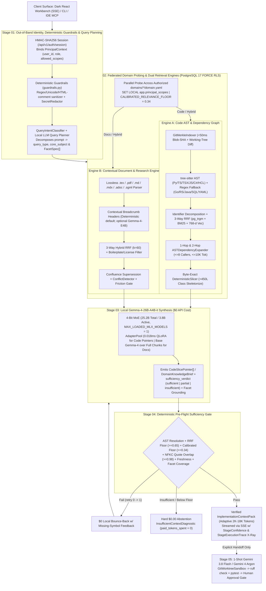

# Enterprise Context Scout

**Enterprise Context Scout** is an open-source reference architecture and local-first research prototype that reduces cloud LLM exploration spend on multi-file codebases and technical document corpora. When teams connect paid cloud models (`Claude Opus 5.5`, `Gemini 4 Argon`, `GPT-5.6 Sol`) directly to large repositories or internal wikis, most billed input tokens are spent **searching around**—scanning folders, opening unrelated files, and guessing across multiple turns—and when your data does not actually contain the answer, you still pay full cloud API rates for a guess. Context Scout places a **free (`$0`) local open-weights AI scout** (`Gemma-4-26B-A4B-it` on local Apple Silicon / private GPU) in front of paid cloud APIs: it searches locally under database-enforced permissions, checks a deterministic quality gate to **stop at `$0.00` when your indexed data lacks sufficient evidence**, and sends **one compact, verified briefing (`~2K–6K` tokens instead of `17K–32K`)** only when paid cloud execution is needed.

- **74%–89% Lower Uncached Cloud API Spend on Multi-File Tasks (with Caveats Below):** On a live $N=30$ two-arm `Gemini 3.8 Flash` coding A/B across 28 repos, task-level paid tokens dropped from `887K` in + `13.3K` out (`111` search turns; `17,473` median input/task) to `60.5K` in + `9.7K` out (`0` search turns; `1,949` median input/task = **`-91.35%` median input tokens / `-88.6%` uncached task bill**, or **`-64.4%`** including full IDE system-prompt transcripts). On $N=30$ unseen merged PRs (`encode/httpx`, `pallets/click`), median input tokens fell **`81.96%`** (`67.44%` mean; `-74.3%` uncached bill), though small single-file fixes can incur negative savings (down to `-145.0%`) when AST dependency closure attaches extra context.
- **`$0.00` Abstention Gate on Out-of-Corpus Queries:** When retrieved evidence falls below calibrated relevance floors or fails deterministic quote/symbol checks, the pipeline returns a structured diagnostic at `0` paid tokens (`14 of 14` on our small Stage 9 live MLX check: `11` in-corpus queries + `3` out-of-corpus traps; see `## Limitations` for where tangential or broad queries still fail).
- **Database-Enforced Access Control & Sandboxed Execution:** Enforces tenant/role scopes inside PostgreSQL 17 (`FORCE ROW LEVEL SECURITY`, `0 of 22` red-team leaks) rather than system prompts, frames untrusted text, and isolates optional cloud code edits in an ephemeral `GitWorktreeSandbox` behind lint, test, and human confirmation gates.

> **Project Maturity Note:** This repository is a **single-node engineering prototype and enterprise reference architecture** validated on modest benchmark suites ($N=14$ to $N=71$ tasks across `50` OSS repos and `45.9K` document chunks)—**not** a battle-tested, high-QPS enterprise search product. Read [Limitations & Known Failure Modes](#limitations--known-failure-modes) before extrapolating small-$N$ pass rates to production workloads.

---

## Why Teams Use It: Cost Economics in Plain Terms

- **Without Scout (Direct Cloud Agent Loop):** Every question or code change triggers a paid multi-turn loop (`3–8` tool turns on average). The cloud model repeatedly scans directories and reads noisy files (`17K–32K` input tokens per task)—and still charges you when the answer is absent from your internal docs.
- **With Enterprise Context Scout:**
  1. **Search Locally at `$0` API Cost:** Local 4-bit `Gemma-4-26B-A4B-it` + PostgreSQL 17 hybrid search absorb the noisy exploration locally on your laptop or private VPC GPU.
  2. **Gate Weak Context at `$0.00`:** A deterministic Pre-Flight Gate verifies symbol resolution, quote overlap, and retrieval scores before any paid API call—blocking unsupported answers at `$0` instead of paying a frontier model to hallucinate.
  3. **Pay Once for Single-Shot Execution:** Only verified context slices (`~2K–6K` tokens) are handed to a paid model (`Gemini 3.8 Flash`, `Gemini 4 Argon`, etc.) for 1-shot execution.

### Frontier Model Cost Savings Comparison (Uncached List-Price Basis)

Only **`Gemini 3.8 Flash`** was executed live in the $N=30$ cloud A/B ([report](reports/senior_eng_30_e2e_ab_report.md)). Rows marked *projected* apply each model's late-2026 uncached list price to those exact measured token totals (`887,092` in + `13,288` out vs. `60,471` in + `9,719` out for the 6-Category A/B; `799,824` in + `12,374` out vs. `186,477` in + `6,995` out for the 30-PR Unseen A/B). Because all six models share a **`1 : 5` input-to-output price ratio**, same-model percentage savings (`-88.6%` on 6-Category task tokens, `-74.3%` on 30-PR tokens) are algebraically constant across rows, while dollar savings and **Hybrid Route** savings scale with model tier:

| Cloud Model (Late-2026 List Price, In / Out per 1M) | Per-Task Avg (`30`-Task Batch): Live 6-Cat $N=30$ | 10,000 Tasks/Mo: 6-Cat Scale (`-88.6%` Same-Model) | 10,000 Tasks/Mo: 30-PR Unseen Scale (`-74.3%` Same-Model) | Hybrid Route @ 10K/Mo (`$0` Local Scout + 1-Shot `Gemini 3.8 Flash`: `$27.27–$55.36`) |
|---|---|---|---|---|
| **Google `Gemini 3.8 Flash`** (`$0.75` / `$3.75`, intro — **live A/B**) | `$0.024` vs **`$0.003`** (`$0.72` vs `$0.08`) | `$238.38` vs **`$27.27`** | `$215.42` vs **`$55.36`** | **`$27.27–$55.36/mo`** (`-74.3%` to `-88.6%`) |
| **Google `Gemini 3.8 Flash`** (`$1.50` / `$7.50`, std — **live A/B**) | `$0.048` vs **`$0.005`** (`$1.43` vs `$0.16`) | `$476.77` vs **`$54.53`** | `$430.85` vs **`$110.73`** | **`$27.27–$55.36/mo`** (`-87.2%` to `-94.3%`) |
| **Google `Gemini 4 Argon`** (`$2.00` / `$10.00`, intro — *projected*) | `$0.064` vs **`$0.007`** (`$1.91` vs `$0.22`) | `$635.69` vs **`$72.71`** | `$574.46` vs **`$147.63`** | **`$27.27–$55.36/mo`** (`-90.4%` to `-95.7%`) |
| **Anthropic `Claude Sonnet 5.5`** (`$2.00` / `$10.00` — *projected*) | `$0.064` vs **`$0.007`** (`$1.91` vs `$0.22`) | `$635.69` vs **`$72.71`** | `$574.46` vs **`$147.63`** | **`$27.27–$55.36/mo`** (`-90.4%` to `-95.7%`) |
| **Google `Gemini 4 Argon`** (`$4.00` / `$20.00`, std — *projected*) | `$0.127` vs **`$0.015`** (`$3.81` vs `$0.44`) | `$1,271.38` vs **`$145.42`** | `$1,148.93` vs **`$295.27`** | **`$27.27–$55.36/mo`** (`-95.2%` to `-97.9%`) |
| **Anthropic `Claude Opus 5.5`** (`$4.00` / `$20.00` — *projected*) | `$0.127` vs **`$0.015`** (`$3.81` vs `$0.44`) | `$1,271.38` vs **`$145.42`** | `$1,148.93` vs **`$295.27`** | **`$27.27–$55.36/mo`** (`-95.2%` to `-97.9%`) |
| **OpenAI `GPT-5.6 Sol`** (`$4.00` / `$20.00` — *projected*) | `$0.127` vs **`$0.015`** (`$3.81` vs `$0.44`) | `$1,271.38` vs **`$145.42`** | `$1,148.93` vs **`$295.27`** | **`$27.27–$55.36/mo`** (`-95.2%` to `-97.9%`) |
| **OpenAI `GPT-6 Astra`** (`$10.00` / `$50.00` — *projected*) | `$0.318` vs **`$0.036`** (`$9.54` vs `$1.09`) | `$3,178.44` vs **`$363.55`** | `$2,872.31` vs **`$738.17`** | **`$27.27–$55.36/mo`** (`-98.1%` to `-99.1%`) |

**Important Accounting Disclosures:**
- **Task Payload vs. Full IDE Transcript:** The `-88.6%` figure above bills repository search/context + patch tokens (`887K` in / `13.3K` out vs. `60.5K` in / `9.7K` out). Including repeated IDE subagent system prompts and tool schemas across `127` vs. `21` planner steps (`5.52M` in / `101K` out vs. `1.42M` in / `146K` out), uncached total cost reduction is **`-64.4%`** (`-74.3%` input tokens).
- **Prompt Caching, Reasoning Tokens & Local Compute Not Modeled Above:** Multi-turn cloud coding agents typically benefit from **75%–90% prompt-cache discounts** on repeated prefixes (which lowers real-world *"Without Scout"* input bills relative to uncached list rates), while reasoning models bill hidden thinking tokens as output. Local `$0` API cost also assumes amortized workstation/GPU hardware (`~19 GB` unified memory/VRAM + electricity).

---

## System Architecture (Engineering Breakdown)

Naive RAG pipelines split code and prose into uniform 500-token chunks, retrieve by dense cosine similarity alone, enforce access control inside system prompts, and forward top-$K$ hits directly to a paid LLM regardless of whether they answer the prompt. Enterprise Context Scout separates the pipeline into **database-enforced security**, **two modality-specific retrieval engines**, **pointer-only local synthesis**, and a **deterministic Pre-Flight Sufficiency Gate**.

### 1. End-to-End Request & Dataflow Topology



### 2. Stage-by-Stage Engineering Mechanics

#### Stage 01 — Out-of-Band Identity, Deterministic Guardrails & Query Planning (`security/`, `agents/intent_router.py`)
- **Input:** Raw prompt + signed HMAC-SHA256 Bearer token minted via `POST /api/v1/auth/session` (disabled in production in favor of external IdP JWTs).
- **Mechanism:**
  1. Binds `PrincipalContext` (`user_id`, `role`, `allowed_scopes`, `max_session_paid_tokens`) to an out-of-band `ContextVar`. MCP tool schemas never accept `user_id` or `allowed_scopes`, so LLM tool calls cannot escalate privileges.
  2. Runs deterministic input sanitization (`PromptInjectionSanitizer` + `SecretRedactor` inside `ShieldGemmaGuardrail.evaluate_deterministic_fallback()`) to block known override signatures, HTML-comment split payloads, Unicode bidi spoofing, and high-entropy secrets (`32 KB` payload cap). *(Note: local runtime uses deterministic regex/Unicode rules rather than live neural `ShieldGemma 2` weights; novel semantic injections rely on Stage 2 SQL RLS and Stage 3 `<untrusted_retrieved_data>` framing.)*
  3. Classifies modality intent (`code | document | hybrid`) and decomposes multi-part prompts (`"top N"`, multi-entity comparisons, acronyms) into clause-anchored `FacetSpec` targets.
- **Output:** Verified `PrincipalContext` + `QueryPlan` + Stage 1 `StageConfidence` and `StageExecutionTrace`.

#### Stage 02 — Federated Domain Probing & Dual Retrieval Engines (`db/`, `ast_engine/`, `ingestion/`)
- **Database Isolation:** Queries execute as non-superuser `scout_app_user` inside a PostgreSQL 17 transaction running `SET LOCAL app.principal_scopes = '...'` and `SET LOCAL hnsw.iterative_scan = 'relaxed_order'` on tables with `ENABLE` + `FORCE ROW LEVEL SECURITY`.
- **Parallel `federated_all` Probing:** Probes every authorized `DomainPack` in `DomainRegistry`, strips license/stub boilerplate (`is_license_or_stub_text`), rejects hits below `CALIBRATED_RELEVANCE_FLOOR = 0.34` (a heuristic linear blend over cosine, BM25, and lexical overlap), and records per-domain `DomainProbeTrace` and per-hit `RetrievalHitTrace` telemetry.
- **Why Two Retrieval Engines Exist (Code $\neq$ Prose):**
  - **Engine A — Code AST & Dependency Graph (`trading_code_scout`, `polyglot_unseen_v2`):**
    1. *Incremental Sync:* `GitMerkleIndexer` diffs `git ls-tree -r HEAD` blob SHAs + working-tree edits (`git status --porcelain`) in `<50 ms`.
    2. *AST + Fallback Extractors:* `ASTExtractor` builds full `tree-sitter` symbol/call graphs (`CALLS`, `IMPORTS`, `USES_TYPE`, `INHERITS`, `TESTED_BY`) for **Python, TypeScript, TSX, JS/JSX, C#, and Terraform HCL** (failing closed on syntax errors), and uses lightweight structural regex/block extractors (`low_confidence_fallback`) for **Go, Rust, Java, SQL DDL, and YAML**, linked across services via `CrossBoundaryContractLinker`.
    3. *Hybrid Search + 2-Hop Closure:* Decomposes `camelCase`/`snake_case` identifiers, fuses `pg_trgm` + BM25 + 768-d `google/embeddinggemma-2` via Normalized RRF, and runs `ASTDependencyExpander` to attach 1-hop and 2-hop types/schemas, up to **`8` diverse callers**, and unit tests within a **`10,000`-token expansion cap** (`<1 ms` indexed CTE over `291,090` edges).
    4. *Byte-Exact Slicing:* `DeterministicSlicer` slices verbatim UTF-8 lines from Git/PostgreSQL with `git_commit_sha`, coalesces adjacent slices in ascending order, attaches file import headers (`L1..last_import_line`), and skeletonizes only unrelated classes `> 450` lines.
  - **Engine B — Contextual Document & Research Engine (`data_engineering_scout`, `quant_research_scout`):**
    1. *Lossless Parsing & Headers:* Parses `.tex`, `.pdf`, `.md`, `.mdx`, `.adoc`, `.sgml`, `.rst`, `.json`, `.csv`, and `.html` while keeping LaTeX math and Markdown/HTML tables intact, and prepends situated breadcrumb/metadata headers (`DeterministicContextualizer` by default on the indexed PG17 corpus; optional `Gemma-4-E4B-it` HTTP contextualizer) before 768-d embedding.
    2. *Lifecycle & Scepticism Filtering:* Scores via 3-way Normalized RRF (`k = 60`) + `CALIBRATED_RELEVANCE_FLOOR = 0.34`, suppresses superseded Confluence versions (`superseded_by`), runs `ConflictDetector` (code vs. stale RFCs), and enforces `QuantScepticismGate` statutory market friction floors (`>= 15 bps` `IN_NSE` delivery, `>= 10 bps` `DE_XETRA`, `>= 5 bps` `US_EQUITY`).

#### Stage 03 — Local `Gemma-4-26B-A4B-it` Synthesis (`agents/scout_workflow.py`, `agents/domain_registry.py`)
- **Mechanism:** Wraps retrieved evidence in `<untrusted_retrieved_data>` delimiters and runs 4-bit `google/gemma-4-26B-A4B-it` MoE (`25.2B` total / `3.8B` active parameters) locally via `mlx-lm`. Memory is bounded by a single-slot process cache (`MAX_LOADED_MLX_MODELS = 1` + `mlx.core.clear_cache()`), `--max-kv-size 32768`, and CPU-pinned query embeddings (`SCOUT_EMBEDDING_DEVICE=cpu`) to avoid Metal buffer contention.
  - **Code Domains (`lora_enabled: true`):** `AdapterPool` hot-swaps rank-16 QLoRA cartridges (`~9.97 MB`, `0.018 ms` switch, 128 MoE `router.proj` gates frozen) to emit `CodeSlicePointer` line coordinates (`-96.65%` prompt overhead) without re-typing source code.
  - **Document/Research Domains (`lora_enabled: false`):** Base `Gemma-4-26B-A4B-it` synthesizes over **full `verbatim_content` chunks** and emits `sufficiency_verdict` (`sufficient | partial | insufficient`), `grounded_facets`, and `missing_or_unverified_aspects`.

#### Stage 04 — Deterministic Pre-Flight Sufficiency Gate & Live X-Ray (`agents/preflight_gate.py`)
- **Mechanism:** Deterministically checks (1) 100% internal AST symbol & modification-target resolution, (2) `normalized_rrf_score >= 0.65` (`DEFAULT_MIN_RRF_SCORE`) and `calibrated_score >= 0.34` computed from live hits, (3) `>= 0.98` NFKC + whitespace-normalized verbatim quote overlap, and (4) freshness, friction, and facet-grounding rules (surfacing partial corpus gaps in `missing_or_unverified_aspects`).
- **Bounce-Back vs. Hard `$0` Abstention:** Failed checks trigger **`max_bounce_backs = 1`** local `$0` retry with diagnostic feedback; if still ungrounded, the pipeline aborts with `InsufficientContextDiagnostic(paid_tokens_spent=0)`. All 4 stages stream calibrated `StageConfidence` and expandable `StageExecutionTrace` telemetry over `POST /api/v1/scout/stream` to the dark React Workbench (`web-ui/`).

#### Stage 05 — Optional 1-Shot Paid Execution in `GitWorktreeSandbox` (`agents/gemini_executor.py`)
- Triggered only on explicit user action (`POST /api/v1/handoff/preview` $\rightarrow$ `POST /api/v1/handoff/apply` or CLI `--handoff-apply`). Sends the verified `ImplementationContextPack` (adaptive `2K–18K` tokens) in 1 shot to `gemini-3.8-flash` (or `gemini-4-argon`), applies edits inside an ephemeral `git worktree` (`scout-exec-<uuid>`) with secrets stripped, runs `ruff check` + `pytest`, and requires human approval before merge.

### 3. Plug-and-Play Multi-Domain Cartridges (`domains/<id>/domain.yaml`)

Dropping a new `domains/<id>/domain.yaml` manifest and running `uv run context-scout sync` automatically registers the domain in `DomainRegistry`, `federated_all`, and the React UI (`GET /api/v1/workspace-config`) with zero core engine or frontend code edits:

| Registered Domain Cartridge | Engine | Live PostgreSQL 17 Corpus | Local Synthesis Mode |
|---|---|---|---|
| `trading_code_scout` | Engine A (Code) | `238` files, `2,495` AST symbols, `25,923` edges | Rank-16 QLoRA (`gemma4_26b_code_scout`) |
| `polyglot_unseen_v2` | Engine A (Code) | `4,232` files, `50,260` AST symbols, `291,090` edges (`50` OSS repos) | Rank-16 QLoRA (`gemma4_26b_polyglot_unseen_v2`) |
| `data_engineering_scout` | Engine B (Docs) | `31,704` `doc_chunks` (`32` OSS doc folders + `200` papers) | Base `Gemma-4-26B-A4B-it` (`lora_enabled: false`) |
| `quant_research_scout` | Engine B (Docs) | `14,188` `doc_chunks` (`~300` `IN_NSE`, `DE_XETRA`, `US_EQUITY` papers) | Base `Gemma-4-26B-A4B-it` (`lora_enabled: false`) |

---

## Results (Small-$N$ Prototype Benchmarks)

| Benchmark / Gate | Measured Result (Raw Counts) | Sample Size ($N$), Method & Bias / Overlap Disclosure |
|---|---|---|
| **Live `Gemini 3.8 Flash` 6-Cat Coding A/B** | **`27 of 30`** initial blind Arm B $\rightarrow$ **`30 of 30`** post-fix re-run vs. `29 of 30` Arm A; **`1,949` vs. `17,473`** median input tokens (`0` vs. `111` search turns) | $N=30$ tasks across 28 repos & 7 langs; **post-hoc tuned disclosure:** `30/30` was re-measured on the *same* 30 tasks after fixing 3 context-shape bugs; robust signal is token reduction, not the 1-task pass gap ([report](reports/senior_eng_30_e2e_ab_report.md)) |
| **Unseen-Repo 30-PR Two-Arm A/B** | **`30 of 30`** File & Symbol `Recall@5` vs. `27 of 30` File / `6 of 30` Symbol (Arm A); **`4,898` vs. `26,509`** median input tokens (`81.96%` median, **`67.44%` mean**, worst `-145.0%`); `29 of 30` frozen QLoRA validity | $N=30$ merged PRs (`15` `encode/httpx`, `15` `pallets/click`) at `parent_commit_sha` on local 4-bit `Gemma-4`; **zero train/eval overlap**; retrieval recall improved post-baseline via stemming heuristics ([report](reports/unseen_repo_ab_report.md)) |
| **50-Repo Polyglot Scale Benchmark** | **`59 of 60`** (`98.33%`) Live QLoRA Schema Validity & File/Symbol `Recall@5` (`14 of 15` on redacted Tier 4); `371 of 371` byte-exact slices; **`1,923` vs. `32,486`** median input tokens | $N=60$ queries across 50 repos (`51,130` snapshot symbols) with `--live-mlx`; **two disclosures:** (1) `Without Scout` (`32,486`) is a static top-4-file counterfactual sum, not a live agent run; (2) all `153` train rows came from `anyio` (1 of 50 repos) ([report](reports/polyglot_unseen_v2_benchmark.md)) |
| **`data_engineering_scout` Holdout & Stress Test** | **`37 of 40`** (`92.5%`) unseen `Recall@5`; `105/105` & `71/71` quote faithfulness; **`13 of 40` (`32.5%`) & `3 of 25` (`12.0%`)** strict QLoRA JSON validity; **`23 of 140` (`16.4%`)** exact-phrase concept coverage | $N=40$ `eval_holdout` + $N=25$ stress test on live MLX ([report](reports/data_engineering_scout_benchmark.md)); this failure (`12%–32.5%` adapter JSON validity, `16.4%` 1-sentence concept coverage) drove Stage 9's switch to full-chunk base `Gemma-4` (`lora_enabled: false`) |
| **Stage 9 Live MLX Unscripted Sanity Check** | **`14 of 14`** passed in `322.95s` (`11` in-corpus queries across 4 domains + `federated_all`, **`3` out-of-corpus `$0` abstentions**) | $N=14$ live PG17 + `CONTEXT_SCOUT_USE_LIVE_MLX=1` regression suite ([test_live_unscripted_semantic_eval.py](tests/test_live_unscripted_semantic_eval.py)); **very small $N$** validating Stage 9 routing/abstention fixes, not broad open-world coverage |
| **10K-Page Wiki & 40-User Concurrent SSE** | **`12 of 12`** noise/stale rejection, `25 of 27` v3 freshness, **`7 of 10`** table lookup, **`2 of 10` (`20%`)** unlinked conflict disambiguation, **`2 of 3`** cross-boundary recall; `40 of 40` HTTP `200` SSE | $N=71$ role queries over `10,000` synthetic-scaled pages (`463` unique public source files) + $N=40$ concurrent ASGI SSE sessions **with `offline_mode=True`** (tests PG17 `FORCE RLS` pooling, not 40x GPU concurrency) ([wiki](reports/enterprise_wiki_10k_qualification.md), [concurrency](reports/polyglot_multiservice_concurrency_qualification.md)) |
| **Security & Own-Repo CI Gates** | **`0 of 22`** cross-role PG17 RLS leaks; **`22 of 22`** known signature injection/secret payloads blocked; `17 of 17` own-repo golden set | $N=22$ PG17 `FORCE RLS` red-team checks + $N=22$ known regex/Unicode injection patterns + $N=17$ same-corpus golden regression set ([report](reports/m6_eval_report.md)) |

---

## Limitations & Known Failure Modes

1. **Small Evaluation Sample Sizes & Post-Hoc Tuning Bias:** Most evaluation suites have $N=14$ to $N=60$ cases (`95%` confidence intervals are wide—e.g., `14/14` has a Wilson lower bound of `~78%`). On the $N=30$ `Gemini 3.8 Flash` coding A/B, Arm B initially scored `27 of 30` vs. Arm A's `29 of 30`; `30 of 30` was measured on the *same* 30 prompts after fixing those 3 context-shape bugs rather than on a fresh untouched holdout. Similarly, `polyglot_unseen_v2` distillation (`153` rows) overlapped `anyio` (1 of 50 repos), and its *"Without Scout"* token baseline is a static 4-file sum rather than a live multi-turn cloud run.
2. **Narrow Local Corpora & Open-Ended / Tangential Query Failures:** The local database indexes `31,704` data-engineering chunks (`32` sparse OSS doc repos + `200` arXiv papers) and `14,188` quant chunks (`~300` papers)—not a comprehensive textbook or enterprise intranet. Arbitrary user questions fail or degrade when:
   - The answer is scattered indirectly across 5+ documents rather than stated cohesively in top-$K$ chunks;
   - Phrasing uses terminology absent from the indexed chunks and falls below `CALIBRATED_RELEVANCE_FLOOR = 0.34` (triggering a conservative false-negative `$0` abstention);
   - The prompt asks for global repository/corpus synthesis (*"list every API endpoint across all services"*, *"summarize all architecture changes this quarter"*), which top-$K$ slice/chunk retrieval cannot answer; or
   - The user asks multi-turn follow-up questions (every request is currently **stateless single-turn** with no conversation memory).
3. **Negative Token Savings on Small Files & Trivial Edits:** Attaching 1-hop/2-hop AST callers, imported types, and file headers adds overhead on tiny target files. On `CLICK-08` (`-17.1%`), `CLICK-09` (`-145.0%`, `16,758` vs. `6,840` tokens), and `SE-17` (`-1.89%`), Context Scout sent *more* tokens than direct exploration. Repositories `<50K` LOC or single-file fixes are often cheaper with direct context caching.
4. **Heuristic Reranking, Unlinked Wiki Conflicts (`2 of 10`) & Disabled Prose LoRA:** Stage 2 uses Normalized RRF + a heuristic linear score (`0.34` floor) rather than a trained neural cross-encoder reranker, and indexed PG17 `doc_chunks` use deterministic section/metadata headers rather than live `Gemma-4-E4B-it` LLM summaries. At `10,000` wiki pages, unlinked `2026`-vs-`2023` conflict disambiguation scored only **`2 of 10` (`20%`)**, dense table lookup scored **`7 of 10`**, and cross-boundary 1-hop contract recall scored **`2 of 3`**. Prose domains (`data_engineering_scout`, `quant_research_scout`) also run with `lora_enabled: false` after 4-bit QLoRA adapters suffered severe JSON looping (`12%–32.5%` strict validity).
5. **Deterministic Stage 1 Guardrails & Partial `tree-sitter` Grammar Coverage:** `ShieldGemmaGuardrail` in `guardrails.py` currently executes deterministic regex, Unicode-bidi, and secret-pattern rules (`used_fallback=True`)—not live neural `ShieldGemma 2` weights—so novel paraphrased prompt injections without known trigger phrases are not caught at Stage 1 (relying instead on SQL `FORCE RLS`, read-only MCP tool schemas, and `<untrusted_retrieved_data>` framing). Likewise, full `tree-sitter` AST grammars cover **Python, TS/TSX/JS/JSX, C#, and Terraform HCL**, whereas **Go, Rust, Java, SQL, and YAML** rely on structural regex fallback parsers.
6. **Single-GPU Latency (`~13–39s`/query), Hardware Footprint & Offline Patching (`1 of 10`):** Live 4-bit `Gemma-4-26B-A4B-it` inference requires `~19 GB` unified memory/VRAM and serializes behind `MAX_LOADED_MLX_MODELS = 1` on a single Apple Silicon GPU (`~13–39s` per live synthesis query; the 40-user SSE test ran with `offline_mode=True`). Without a paid cloud `GEMINI_API_KEY`, offline quantized local patching passed only **`1 of 10`** SWE-bench `FAIL_TO_PASS` `pytest` checks (`CLICK-01`).

---

## Quickstart

**Prerequisites:** Python `3.12+` with [`uv`](https://docs.astral.sh/uv/), Node.js `20+`, and PostgreSQL 17 with `pgvector` and `pg_trgm` (Docker or Homebrew; add `~19 GB` unified memory on Apple Silicon for `CONTEXT_SCOUT_USE_LIVE_MLX=1`).

```bash
# 1. Clone, install dependencies, and start PostgreSQL 17
git clone https://github.com/himanshu2408/enterprise-context-scout.git && cd enterprise-context-scout
uv sync --extra dev && (cd web-ui && npm install)
docker compose up -d postgres && cp .env.example .env

# 2. Seed baseline AST graph and corpus into PostgreSQL 17 under FORCE RLS
uv run python -m context_scout.mcp_servers.seed_code_corpus

# 3. Start FastAPI SSE backend (:8080) with live MLX and Dark React Workbench (:5173)
CONTEXT_SCOUT_USE_LIVE_MLX=1 SCOUT_EMBEDDING_DEVICE=cpu uv run uvicorn context_scout.api.main:app --host 127.0.0.1 --port 8080 --reload
cd web-ui && npm run dev

# 4. Run automated verification suites (56 Python suites / 687 tests + 8 Vitest suites / 60 UI tests)
make test-full
cd web-ui && npm run lint && npm run typecheck && npm run test && npm run build
```

To onboard your own codebase or document folder as a new `DomainPack`:

```bash
uv run context-scout init-domain --domain-id my_repo_scout --domain-type code --display-name "My Repo Scout" --source-dir /path/to/repo
uv run context-scout sync --domain-id my_repo_scout
uv run context-scout query --domain-id my_repo_scout --prompt "Locate auth middleware and verify token expiry checks"
```

---

## Technical Documentation (`docs/`)

| Guide | What It Covers |
|---|---|
| **[docs/ARCHITECTURE_DEEP_DIVE.md](docs/ARCHITECTURE_DEEP_DIVE.md)** | Internal pipeline contracts, `StageExecutionTrace` & `StageConfidence`, Engine A (`tree-sitter` + regex fallback) & Engine B internals, MLX single-slot GPU memory management, and SSE protocol. |
| **[docs/CUSTOM_DOMAINS_AND_TRAINING.md](docs/CUSTOM_DOMAINS_AND_TRAINING.md)** | Declarative `domains/<id>/domain.yaml` schema, zero-code UI/router auto-discovery, CLI ingestion & corpus cleaning, teacher trace distillation, and local MLX / Vertex AI PEFT QLoRA training. |
| **[docs/SECURITY_AND_GOVERNANCE.md](docs/SECURITY_AND_GOVERNANCE.md)** | Out-of-band HMAC `PrincipalContext`, PostgreSQL 17 `FORCE ROW LEVEL SECURITY`, deterministic vs. neural guardrails, `$0` abstention, `GitWorktreeSandbox`, and enterprise GCP target mapping. |
| **[docs/BENCHMARKS_AND_ENGINEERING_LOG.md](docs/BENCHMARKS_AND_ENGINEERING_LOG.md)** | Complete A/B benchmark ledger ($N$, CIs, post-hoc tuning & overlap disclosures), Stage 1–9 iterative engineering progression log, and exact reproduction commands. |
| **[docs/PLUGIN_CONNECTOR_AUTHORING_GUIDE.md](docs/PLUGIN_CONNECTOR_AUTHORING_GUIDE.md)** | Extending `LanguagePlugin`, `DomainPlugin`, and `SourceConnectorPlugin` interfaces. |
| **[ARCHITECTURE_BLUEPRINT.md](ARCHITECTURE_BLUEPRINT.md)** | Original system design blueprint, target GCP architecture, Pydantic contracts, and SQL DDL specification. |
