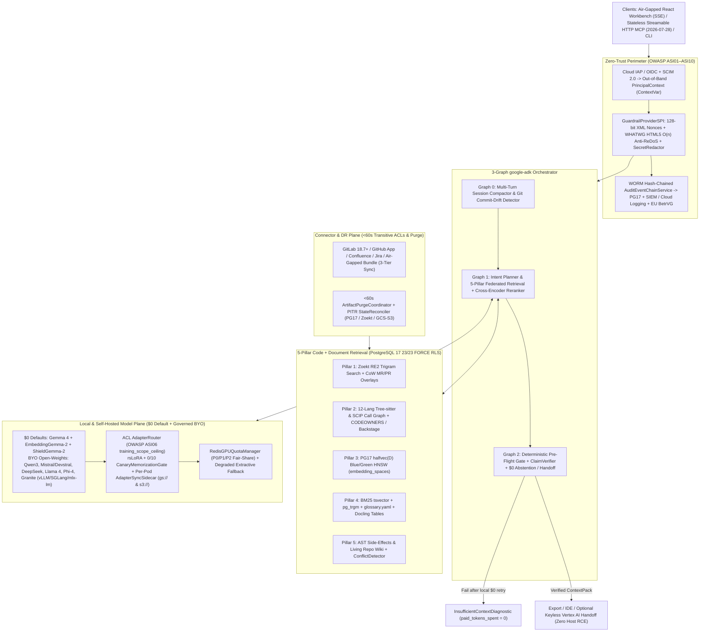

# Enterprise Context Scout (`v1.0.0`)

**Enterprise Context Scout** is a 100% self-hosted, cloud- and model-agnostic **Enterprise Context Control Plane** for private VPCs and air-gapped Kubernetes clusters. It sits in front of coding agents, IDE MCP clients, and internal engineering assistants to resolve multi-repository codebases and enterprise wikis locally at `$0` API cost—enforcing tenant and document ACLs inside the PostgreSQL 17 kernel, verifying every citation and symbol deterministically before synthesis, and abstaining at `$0.00` paid tokens when indexed evidence is insufficient.

---

## Problem Statement

Connecting commercial frontier LLMs or naive vector RAG pipelines directly to enterprise repositories and wikis fails on four axes:

1. **Exploratory Token Burn:** Multi-turn coding and investigation loops spend 75–92% of input tokens scanning directories, reading unrelated files, and chasing imports—and still bill full API rates when the corpus lacks the answer.
2. **Broken Code Context:** Fixed-size dense chunking severs functions from imported types, cross-service contracts, callers, and test fixtures, while failing on exact identifier renames and unmerged MR/PR diffs.
3. **Prompt-Level Security Gaps:** Enforcing RBAC/ABAC in system prompts or unisolated vector databases leaks restricted repositories, Confluence subtrees, and LoRA-memorized tenant data across user boundaries.
4. **Vendor & Model Lock-In:** Hardcoding a single cloud LLM, embedding dimension, or proprietary cloud runtime blocks regulated enterprises from running self-hosted open-weights models (`Gemma 4`, `Qwen3`, `Mistral/Devstral`, `DeepSeek`, `Llama 4`, `Phi-4`, `IBM Granite`) inside air-gapped networks.

---

## System Architecture



---

## Core Architectural Pillars

### 1. 5-Pillar Code + Document Retrieval & 3-Graph `google-adk` Orchestrator
- **Pillar 1 (Exact & Overlay Search):** Zoekt RE2 trigram code search paired with Copy-on-Write (CoW) merge-request overlays (`ref_snapshots`, `overlay_file_deltas`) so unmerged branches are searchable in isolation without mutating the base index.
- **Pillar 2 (12-Language AST/SCIP & Ownership):** Tree-sitter and SCIP extractors across 12 languages (Python, TypeScript/TSX, JavaScript/JSX, C#/.NET, Terraform HCL, Go, Rust, Java, SQL, YAML, Templates/i18n, React/Redux/Storybook) with fail-closed syntax-error abstention, `<250 ms` anti-ReDoS bounds, cross-boundary contract edges, and `CODEOWNERS` / Backstage ownership attribution.
- **Pillar 3 (Zero-Downtime Vectors):** PostgreSQL 17 `halfvec(D)` HNSW indexes managed by `embedding_spaces` blue/green shadow re-indexing (`768d <-> 1024d` / `2560d`) with `hnsw.iterative_scan = 'relaxed_order'` under RLS.
- **Pillar 4 (Lexical, Glossary & Document Structure):** PostgreSQL FTS (`tsvector` BM25) + `pg_trgm` + domain `glossary.yaml` synonym expansion + lossless Docling/LaTeX table parsing + version-supersession filtering.
- **Pillar 5 (Side-Effects & Living Repo Wiki):** Deterministic AST side-effect extraction (`side_effects` table: DB writes, HTTP calls, queue publishes, lock acquisitions), living repository wiki summaries, and code-vs-stale-RFC `ConflictDetector`.
- **3-Graph Orchestration & Reranking:** `Graph 0` (`SessionCompactor`) compacts multi-turn history and detects Git commit drift; `Graph 1` executes federated retrieval and cross-encoder reranking with recency/archival calibration; `Graph 2` runs `PreFlightValidator` (normalized RRF floor, AST symbol resolution, verbatim NFKC quote overlap, `ClaimVerifier`) with `$0` local bounce-back and fail-closed `$0.00` abstention (`InsufficientContextDiagnostic`).

### 2. PostgreSQL 17 `23/23` `FORCE RLS` & `<60s` Transitive ACL / Purge Engine
- **Database Kernel Isolation:** All `23 / 23` public tables across Alembic migrations `0001`–`0023` (linted zero-violation by `squawk --pg-version=17.0`) enforce `tenant_id UUID NOT NULL`, `ENABLE ROW LEVEL SECURITY`, and `FORCE ROW LEVEL SECURITY`. Runtime pools (`query_pool`, `ingestion_pool`) connect strictly as `scout_app_user` (`NOSUPERUSER NOBYPASSRLS NOINHERIT`); runtime routes and distillation jobs never receive `db_admin_url`.
- **Transitive ACL Mirroring (`<60s`):** 3-tier sync (webhooks + watermark delta poll + periodic reconcile) with `429` Retry-After backoff across GitLab `18.7+` nested groups, GitHub App installations, Confluence page ancestor restrictions, Jira issue/comment security levels, and offline air-gapped bundles.
- **Instant Secret Purge & PITR DR:** `ArtifactPurgeCoordinator` (`context-scout purge-artifact` & `POST /api/v1/admin/purge`) deletes artifacts across PostgreSQL 17, derived wiki/overlays/symbols, permission caches, and GCS/S3 object keys in `<60s` with post-purge residue verification; `StateReconciler` heals cross-store watermark drift after PostgreSQL PITR restores.

### 3. `$0` Gemma 4 Defaults + Governed BYO Open-Weights & ACL-Safe Multi-LoRA
- **Zero Lock-In Model Plane:** Preserves `google/gemma-4-26B-A4B-it`, `mlx-community/gemma-4-26b-a4b-it-4bit`, `google/embeddinggemma-2`, and `google/shieldgemma-2-2b-it` as `$0` defaults while supporting enterprise BYO open-weights models (`Qwen3`/`Qwen3-Coder`, `Mistral`/`Devstral`, `DeepSeek-V3`/`R1`, `Llama 4`, `Phi-4`, `IBM Granite`, `BAAI/bge-m3`) via `vLLM`, `SGLang`, or `mlx-lm`. `ModelGovernancePolicy` (`config/model_registry.yaml`) enforces `.safetensors`-only weights, `trust_remote_code=False`, SPDX license allowlists, and `allow_external_cloud_egress=false` by default.
- **Declarative Specialization (`specialization.yaml`):** `SpecializationCompiler` compiles all 5 domain specialization archetypes (`code_architecture_scout`, `data_engineering_scout`, `enterprise_docs_scout`, `polyglot_unseen_v2`, and `custom_json_contract`) with zero core engine changes.
- **ACL-Safe `rsLoRA` & Fleet Serving:** Enforces `use_rslora=True`, `use_dora=False`, `rank in {8, 16, 32}`, `assistant_only_loss=True`, frozen MoE router gates & Mamba SSM states, `15%` general replay buffer, 3-way SHA-256 disjoint `train`/`valid`/`eval` splits, `0/10` `CanaryMemorizationGate`, `OWASP ASI06` `AdapterRouter` (`set(training_scope_ceiling) <= set(principal.allowed_scopes)`), and per-pod `AdapterSyncSidecar` (`gs://` & `s3://`, Sigstore `CosignBlobVerifier`, `vllm#12174` fleet load/unload rollback).

### 4. Defense-in-Depth `OWASP ASI01`–`ASI10`, Stateless MCP & Air-Gapped UI
- **Prompt Injection & Supply-Chain Hardening:** Per-request 128-bit random XML nonces (`frame_untrusted_content`), single-pass $O(n)$ anti-ReDoS + 11-state WHATWG HTML5 scanner (`<= 31 ms` on `130 KB` stress payloads), NFKC/homoglyph folding, `SecretRedactor`, and CycloneDX `1.6` AI-BOM (`scripts/generate_aibom.py`).
- **Zero Host Code Execution (`ASI05`):** `0` `shell=True` calls in `src/context_scout/`; `POST /api/v1/handoff/apply` rejects `custom_patch` (`HTTP 400`); host-side `pytest` invocation and arbitrary repository mutation on the API host are strictly prohibited.
- **Enterprise Identity, Privacy & Compliance:** Google Cloud IAP (`ES256`) + OIDC JWT verification, SCIM 2.0 group/user provisioning, EU Works Council (BetrVG §87) telemetry anonymization, WORM hash-chained `audit_events` exported to SIEM/Cloud Logging (with SSRF protection), and stateless Streamable HTTP MCP (`2026-07-28`) with out-of-band `PrincipalContext` binding.
- **Air-Gapped React Workbench (`web-ui/`):** Zero external runtime network requests (`0` CDN/font/telemetry egress), 5 self-hosted `.woff2` fonts, strict CSP, WCAG 2.2 AA accessibility, and 3 role-specific workspaces (Engineer, Product Manager, Compliance Officer).

---

## 5-Minute Local Quickstart

**Prerequisites:** Python `3.12+` with [`uv`](https://docs.astral.sh/uv/), Node.js `20+`, and Docker (for PostgreSQL 17 with `pgvector` and `pg_trgm`).

```bash
# 1. Install backend and frontend dependencies
uv sync --extra dev
npm --prefix web-ui install

# 2. Configure local environment and start PostgreSQL 17
cp .env.example .env
docker compose up -d postgres

# 3. Apply Alembic migrations (0001–0023) and seed the demo corpus under PG17 FORCE RLS
uv run context-scout seed-demo

# 4. Start the FastAPI backend (:8080) and air-gapped React Workbench (:5173)
uv run uvicorn context_scout.api.main:app --env-file .env --host 127.0.0.1 --port 8080
npm --prefix web-ui run dev
```

**Optional Live Model Runtimes:**
- **Apple Silicon (`mlx-lm`, ~19 GB unified memory for 4-bit Gemma 4 26B-A4B):**
  ```bash
  CONTEXT_SCOUT_USE_LIVE_MLX=1 SCOUT_EMBEDDING_DEVICE=cpu \
    uv run uvicorn context_scout.api.main:app --env-file .env --host 127.0.0.1 --port 8080
  ```
- **GPU `vLLM` / `SGLang` Endpoint (Gemma 4 or BYO `Qwen3` / `Devstral` / `Llama 4`):** Set `SCOUT_VLLM_BASE_URL` (e.g. `http://127.0.0.1:8000`) and `SCOUT_CHAT_MODEL_ID` in `.env`, or run `uv run context-scout query --domain-id code_architecture_scout --vllm --prompt "..."`.

**Headless Backend & IDE Middleware Verification (`verify-backend`):**
Enterprise Context Scout operates headless as an IDE Stateless Streamable HTTP MCP (`2026-07-28`) and enterprise chatbot context middleware (`/mcp/code/mcp`, `/mcp/docs/mcp`, `/api/v1/scout/{query,stream}`, `/api/v1/handoff/{preview,apply}`) as well as via the optional reference React workbench (`web-ui/`). Run the permanent **60-case, 5-category** backend & MCP middleware grounding + `$0` out-of-domain abstention suite (`24` grounded, `14` `$0` rejection/decoy, `6` MCP/overlay/multi-turn/handoff middleware flows, `4` security/RBAC/WORM audit, `12` foundational/federated):
```bash
# Default PG17 backend & Stateless HTTP MCP middleware authenticity suite
make verify-backend

# Same 60-case suite with live Apple Silicon Gemma-4 Metal execution
uv run context-scout verify-backend --postgres --live-mlx
```

**Verify Locally (Zero-Skip Gate Suite):**
```bash
bash .agents/skills/gate-verify/scripts/run_compact_gates.sh --scope all
```

---

## Production Deployment Guide

| Target Platform | IaC / Manifest Path | Key Capabilities |
|---|---|---|
| **Google Cloud GKE (Primary Reference)** | [`deploy/terraform/gcp-gke/`](deploy/terraform/gcp-gke/main.tf) + [`deploy/helm/context-scout/values-gcp-gke.yaml`](deploy/helm/context-scout/values-gcp-gke.yaml) | Keyless GKE Workload Identity (`0` SA keys), Cloud SQL PostgreSQL 17 over Private Service Connect (`autoIamAuthn`), Memorystore Redis, CMEK GCS artifact store (`gs://`), Cloud Armor, Cloud IAP, optional keyless Vertex AI handoff |
| **AWS EKS / Azure AKS / On-Prem K8s** | [`deploy/terraform/aws-eks/`](deploy/terraform/aws-eks/main.tf), [`deploy/terraform/azure-aks/`](deploy/terraform/azure-aks/main.tf), [`deploy/terraform/onprem-k8s/`](deploy/terraform/onprem-k8s/main.tf) + [`deploy/helm/context-scout/values.yaml`](deploy/helm/context-scout/values.yaml) | Portable IRSA / Azure Workload Identity / air-gapped K8s overlays with `s3://` object storage, KEDA worker autoscaling, NetworkPolicies, and `vllm-statefulset` + `AdapterSyncSidecar` |
| **Single-Host Enterprise Compose** | [`docker-compose.enterprise.yml`](docker-compose.enterprise.yml) + [`deploy/docker/`](deploy/docker/) | Distroless non-root (`uid=65532`) Python containers (`api`, `worker`, `sidecar`), Alpine nginx air-gapped `webui`, one-shot `db-migrate`, zero `SCOUT_DB_ADMIN_URL` in runtime services |
| **Domain Dogfooding Example (Isolated)** | [`examples/quant_dogfood/`](examples/quant_dogfood/) | Reference domain plugin demonstrating custom contracts, harvesters, and evaluation datasets strictly isolated from core `src/`, `sql/`, `domains/`, and `web-ui/` |

---

## Measured Verification Scorecard (`L1`–`L12`)

Full empirical evidence, 95% Wilson confidence intervals, environment disclosures, and reproducible commands are published in **[`reports/v1_ga_release_scorecard.md`](reports/v1_ga_release_scorecard.md)**.

| Gate | Verification Scope | Measured Result | Status |
|---|---|---|---|
| **L1: Static, Types & Neutrality** | `ruff`, `mypy --strict`, `web-ui` lint/tsc/build, domain neutrality | `0` errors across Python & TypeScript; `FINANCE_PLUGIN_ALLOWLIST == frozenset()` | **PASS** |
| **L2: Zero-Skip Test Suite** | Full `pytest` (incl. live PG17 / Testcontainers) & `vitest` | `1045/1045` `pytest` (`84` modules, `0` failed, `0` skipped); `75/75` `vitest` (`10` suites, `0` skipped) | **PASS** |
| **L3: Kernel `FORCE RLS` & Alembic** | `squawk` PG17 DDL lint + catalog audit (`pg_class`/`pg_roles`) | `22` migrations (`0002`–`0023`) `0` violations; `23/23` tables `FORCE RLS` (`NOBYPASSRLS`) | **PASS** |
| **L4: Transitive ACLs & `<60s` Purge** | GitLab `18.7+`, GitHub App, Confluence, Jira, air-gap bundle, purge | `100%` pass across all connector ACL, `429` backoff, and `<60s` purge suites | **PASS** |
| **L5: Polyglot AST/SCIP & Overlays** | 12-lang AST/SCIP, anti-ReDoS `<250ms`, CoW MR overlays, Docling | `100%` pass; `100 KB` HCL `~24.7 ms` under heavy GC; syntax errors fail closed | **PASS** |
| **L6: Retrieval, 10K Wiki & Economics** | PG17 eval harness, 60-case `verify-backend` MCP suite, `10,000`-page wiki (`N=71`) | Recall@5 `5/5 (100%)`, Faithfulness `96/96` code & `64/64` doc (`100%`), Token Savings `92.24%`, 10K Wiki Conflicts `10/10`, Freshness `27/27`, Refusals `0/51`; 60-case `verify-backend` suite regression-verified | **PASS** |
| **L7: OWASP `ASI01`–`ASI10` & Fuzzing** | Security matrix, Schemathesis OpenAPI fuzzing, mutation gates | `21/21` OWASP matrix; `62/62` Schemathesis subtests (`0` 5xx); `406/456 (89.04%)` AST mutation kill (`529/529` `mutmut`) | **PASS** |
| **L8: BYO-LLM & Multi-LoRA Safety** | Multi-family BYO, `rsLoRA`, 3-way splits, `0/10` canary, sidecar | `4/4` shipped domain packs pass `check_splits_and_ceiling.py`; `0/10` canary leak | **PASS** |
| **L9: Concurrency & Chaos DR** | `50` mixed-tenant SSE+MCP, `P0/P2` preemption, PITR DR | `50/50` (`25` SSE + `25` MCP) `0` leaks; `vLLM` degraded fallback & `StateReconciler` pass | **PASS** |
| **L10: Air-Gapped UI & WCAG 2.2 AA** | Vitest + axe WCAG 2.2 AA + live browser network/CSP audit | `75/75` Vitest, `5/5` self-hosted `.woff2`, `63/63` local requests (`0` external), `0` CSP errors | **PASS** |
| **L11a: IaC, AI-BOM & App Scans** | Helm, Terraform, CycloneDX `1.6` AI-BOM, Trivy, Gitleaks | `0` Python-pkg / `webui` / secret CVEs; `0` Gitleaks findings; `97`-component signed AI-BOM | **PASS** |
| **L11b: Distroless Base OS Image** | Upstream `gcr.io/distroless/python3-debian12:nonroot` OS layer | `0` app/webui CVEs; upstream Debian 12 OS-layer CVEs formally risk-accepted (`v1.1.0` migration tracked) | **DOCUMENTED** |
| **L12: Release Hygiene & Scorecard** | Tracked-file hygiene, citation parity, GA scorecard | `0` internal scaffolding identifiers across `git ls-files`; `100%` tracked-path citations | **PASS** |

---

## Documentation Index

| Document | Contents |
|---|---|
| **[`ARCHITECTURE_BLUEPRINT.md`](ARCHITECTURE_BLUEPRINT.md)** | Full `v1.0.0` system architecture, 23-table Alembic PostgreSQL 17 schema (`0001`–`0023`), Pydantic v2 contracts, 5-pillar retrieval, 3-graph ADK orchestration, and BYO-LLM/rsLoRA design |
| **[`docs/SECURITY_AND_GOVERNANCE.md`](docs/SECURITY_AND_GOVERNANCE.md)** | Zero-trust Cloud IAP/OIDC/SCIM auth, PG17 `FORCE RLS`, `OWASP ASI01`–`ASI10` controls, zero host RCE, WORM audit chain, and deployment topology |
| **[`reports/v1_ga_release_scorecard.md`](reports/v1_ga_release_scorecard.md)** | Authoritative `v1.0.0` `L1`–`L12` verification scorecard with Wilson CIs, mutation testing, OpenAPI fuzzing, and environment disclosures |
| **[`docs/ARCHITECTURE_DEEP_DIVE.md`](docs/ARCHITECTURE_DEEP_DIVE.md)** | Deep dive into internal pipeline stages, AST closure, contextual document indexing, and SSE streaming |
| **[`docs/CUSTOM_DOMAINS_AND_TRAINING.md`](docs/CUSTOM_DOMAINS_AND_TRAINING.md)** | Authoring declarative `domains/<id>/{domain,specialization,glossary}.yaml` packs, distillation, and `rsLoRA` training |
| **[`docs/PLUGIN_CONNECTOR_AUTHORING_GUIDE.md`](docs/PLUGIN_CONNECTOR_AUTHORING_GUIDE.md)** | Implementing custom `LanguagePlugin`, `DomainPlugin`, and `SourceConnectorPlugin` extensions |
| **[`TEST_INFRA.md`](TEST_INFRA.md)** | Dual-track E2E test architecture, statistical evaluation bounds (Clopper-Pearson / Wilson), and verification gates |
| **[`docs/BENCHMARKS_AND_ENGINEERING_LOG.md`](docs/BENCHMARKS_AND_ENGINEERING_LOG.md)** | Historical A/B benchmark ledger, confidence intervals, and engineering progression log |
