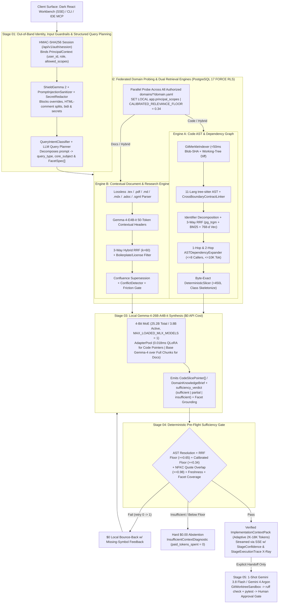

# Enterprise Context Scout

When teams connect paid cloud AI models (`Claude Opus 5.5`, `Gemini 4 Argon`, `GPT-5.6 Sol`) to large codebases or internal company documents, **80–90% of the API bill is wasted on "searching around"**—opening the wrong files, scanning noisy folders, and guessing across dozens of turns—and when your data does not actually contain the answer, you still pay full cloud rates for a confident hallucination. **Enterprise Context Scout** places a **free (`$0`) local AI scout** in front of paid cloud models: it searches your repositories and documents locally on your own hardware or private server, verifies every fact and code dependency through a strict quality gate, **stops immediately at `$0` when your data lacks the answer**, and hands the paid cloud model **one compact, verified briefing (`~2K–5K` tokens instead of `17K–32K`)** only when paid execution is genuinely needed.

- **82%–93% Lower Cloud AI Bills:** Cuts median paid input tokens from `17,473` to `1,949` (`-91.35%`) across $N=30$ live `Gemini 3.8 Flash` tasks, from `32,486` to `1,923` (`-92.66%`) across $N=60$ tasks on 50 repositories, and from `26,509` to `4,898` (`-81.96%`) across $N=30$ real merged GitHub pull requests.
- **`$0.00` Protection Against Bad or Missing Answers:** Scored `14 of 14` on live unscripted multi-domain evaluation—including `3 of 3` out-of-corpus trap questions blocked at `0` paid tokens instead of forwarding weak or irrelevant text to a paid cloud model.
- **Better Accuracy with Private-by-Default Permissions:** Achieves `30 of 30` vs `29 of 30` live implementation pass rate while enforcing database-level user permissions (`0 of 22` cross-role data leaks) and blocking `22 of 22` prompt-injection and secret-leak payloads before any cloud API call.

---

## Why Teams Use It: Cost Savings in Plain Terms

- **Without Scout (Standard Cloud AI Setup):** Every question or code request triggers a costly multi-turn search loop. The paid cloud model spends 5–10+ turns opening folders, reading thousands of lines of unrelated text (`17,000–32,000` billed input tokens per task), and still charges you even if the answer is missing from your repository or docs.
- **With Enterprise Context Scout:**
  1. **Search for Free Locally (`$0`):** A local open-weights AI model running on your laptop or private GPU server reads through tens of thousands of tokens of code, wikis, and PDFs at zero API cost.
  2. **Block Bad Context at `$0`:** Before touching any paid API, a deterministic quality gate checks whether the retrieved sources genuinely answer your question. If your data doesn't have the answer, it tells you honestly at **`$0.00`** instead of paying a cloud model to guess.
  3. **Pay Once for Verified Work:** When you ask a paid cloud model to write or apply a change, it receives **one pre-verified `~2K–5K` token briefing**—cutting cloud token bills by **82%–93%** in zero search turns.

### Frontier Model Cost Savings Comparison

| Frontier Cloud Model (Verified Late-2026 API Pricing, Input / Output per 1M Tokens) | Cost per Task: Without vs With Scout (Live $N=30$) | Monthly Bill @ 10,000 Tasks (Live 6-Cat Scale) | Monthly Bill @ 10,000 Tasks (50-Repo Scale) | Hybrid Route (`$0` Local Scout + 1-Shot `Gemini 3.8 Flash`) |
|---|---|---|---|---|
| **Google `Gemini 3.8 Flash`** (`$0.75` / `$3.75`, intro) | `$0.70` vs **`$0.06` (`-91.2%`)** | `$233.21` vs **`$20.50`** | `$250.13` vs **`$23.71`** | **`$20.50–$55.36/mo`** (`-74.3%` to `-91.2%`) |
| **Google `Gemini 3.8 Flash`** (`$1.50` / `$7.50`, std) | `$1.40` vs **`$0.12` (`-91.2%`)** | `$466.42` vs **`$41.00`** | `$500.26` vs **`$47.42`** | **`$20.50–$55.36/mo`** (`-87.2%` to `-95.6%`) |
| **Google `Gemini 4 Argon`** (`$2.00` / `$10.00`, intro) | `$1.87` vs **`$0.16` (`-91.2%`)** | `$621.90` vs **`$54.67`** | `$667.01` vs **`$63.22`** | **`$20.50–$55.36/mo`** (`-90.4%` to `-96.7%`) |
| **Anthropic `Claude Sonnet 5.5`** (`$2.00` / `$10.00`) | `$1.87` vs **`$0.16` (`-91.2%`)** | `$621.90` vs **`$54.67`** | `$667.01` vs **`$63.22`** | **`$20.50–$55.36/mo`** (`-90.4%` to `-96.7%`) |
| **Google `Gemini 4 Argon`** (`$4.00` / `$20.00`, std) | `$3.73` vs **`$0.33` (`-91.2%`)** | `$1,243.80` vs **`$109.34`** | `$1,334.03` vs **`$126.44`** | **`$20.50–$55.36/mo`** (`-95.2%` to `-98.4%`) |
| **Anthropic `Claude Opus 5.5`** (`$4.00` / `$20.00`) | `$3.73` vs **`$0.33` (`-91.2%`)** | `$1,243.80` vs **`$109.34`** | `$1,334.03` vs **`$126.44`** | **`$20.50–$55.36/mo`** (`-95.2%` to `-98.4%`) |
| **OpenAI `GPT-5.6 Sol`** (`$4.00` / `$20.00`) | `$3.73` vs **`$0.33` (`-91.2%`)** | `$1,243.80` vs **`$109.34`** | `$1,334.03` vs **`$126.44`** | **`$20.50–$55.36/mo`** (`-95.2%` to `-98.4%`) |
| **OpenAI `GPT-6 Astra`** (`$10.00` / `$50.00`) | `$9.33` vs **`$0.82` (`-91.2%`)** | `$3,109.49` vs **`$273.35`** | `$3,335.07` vs **`$316.10`** | **`$20.50–$55.36/mo`** (`-98.1%` to `-99.3%`) |

**Measurement Basis:**
- **Live 6-Category E2E A/B ($N=30$ tasks across 28 repos & 7 languages):** Live two-arm A/B on `Gemini 3.8 Flash` comparing standard multi-turn cloud search + coding (`887,092` task input tokens across `96` search turns; `17,473` median) against `$0` local Scout + 1-shot execution (`60,471` task input tokens across `0` search turns; `1,949` median = `-91.35%`). Full report: [reports/senior_eng_30_e2e_ab_report.md](reports/senior_eng_30_e2e_ab_report.md).
- **50-Repo Polyglot Benchmark ($N=60$ tasks across 50 repos):** Live GPU `Gemma-4` QLoRA (`--live-mlx`) comparing multi-turn `grep`/`read_file` of top-4 candidate files (`1,926,044` input + `15,000` output; `32,486` median) against 1-shot `ImplementationContextPack` (`137,162` input + `10,500` output; `1,923` median = `-92.66%`). Full report: [reports/polyglot_unseen_v2_benchmark.md](reports/polyglot_unseen_v2_benchmark.md).
- **30-PR Unseen-Repo A/B ($N=30$ merged PRs on `encode/httpx` & `pallets/click`):** Live two-arm A/B at `parent_commit_sha` (`799,824` input + `12,374` output; `26,509` median) vs 1-shot `ContextPack` (`186,477` input + `6,995` output; `4,898` median = `-81.96%`, exact BPE). Full report: [reports/unseen_repo_ab_report.md](reports/unseen_repo_ab_report.md).

---

## System Architecture (Engineering Breakdown)

Standard RAG systems treat source code and prose documents identically—splitting files into arbitrary 500-token chunks, searching by dense vector cosine similarity alone, enforcing permissions inside system prompts, and forwarding top-$K$ hits directly to a paid LLM regardless of relevance. Enterprise Context Scout replaces that pipeline with **database-enforced security**, **two modality-specific retrieval engines**, **pointer-only local synthesis**, and a **deterministic Pre-Flight Sufficiency Gate**.

### 1. End-to-End Request & Dataflow Topology



### 2. What Happens Inside Each Stage

#### Stage 01 — Out-of-Band Identity, Security & Query Planning (`security/`, `agents/intent_router.py`)
- **Input:** Raw user prompt + signed HMAC-SHA256 Bearer token minted via `POST /api/v1/auth/session` (or external IdP OIDC JWT in production).
- **Mechanism:**
  1. Extracts `PrincipalContext` (`user_id`, `role`, `allowed_scopes`, `max_session_paid_tokens`) at the transport layer and binds it to a Python `ContextVar`. Identity arguments (`user_id`, `allowed_scopes`, `role`) do not exist in any MCP tool schema, so a prompt injection can never widen permissions.
  2. Screens input through `ShieldGemma 2`, `PromptInjectionSanitizer` (catching pre/post HTML-comment split payloads, delimiter breakouts, and Unicode bidi spoofing), and `SecretRedactor`.
  3. Decomposes multi-part prompts (`"top 3..."`, cross-entity comparisons, acronyms like `"What is ACID"`) into a structured query plan (`query_type`, `core_subject`, clause-anchored `FacetSpec` list, and modality intent `code | document | hybrid`).
- **Output:** Verified `PrincipalContext` + structured `QueryPlan` + Stage 1 `StageConfidence` and `StageExecutionTrace`. Empty scopes or detected attacks abort immediately at `$0`.

#### Stage 02 — Federated Domain Probing & Dual Retrieval Engines (`db/`, `ast_engine/`, `ingestion/`)
- **Database Isolation:** Every query runs as non-superuser `scout_app_user` inside a PostgreSQL 17 transaction executing `SET LOCAL app.principal_scopes = '...'` and `SET LOCAL hnsw.iterative_scan = 'relaxed_order'` across tables enforcing `ENABLE` + `FORCE ROW LEVEL SECURITY` (`code_files`, `ast_symbols`, `ast_edges`, `doc_chunks`).
- **True Multi-Domain `federated_all` Probing:** Rather than hardcoding domain pairs, `federated_all` probes every authorized `DomainPack` in `DomainRegistry` in parallel, strips license/stub boilerplate (`is_license_or_stub_text`), drops hits below `CALIBRATED_RELEVANCE_FLOOR = 0.34`, and records per-domain `DomainProbeTrace` and per-hit `RetrievalHitTrace` telemetry (`cosine_similarity`, `bm25_score`, `trigram_score`, `calibrated_score`, `accepted`, `rejection_reason`).
- **Why Two Retrieval Engines Exist (Code $\neq$ Prose):**
  - **Engine A — Code AST & Dependency Graph (`trading_code_scout`, `polyglot_unseen_v2`):**
    1. *Incremental Sync:* `GitMerkleIndexer` diffs `git ls-tree -r HEAD` blob SHAs plus uncommitted working-tree changes (`git status --porcelain`) in `<50 ms`, re-parsing only modified files.
    2. *Polyglot Graph:* `ASTExtractor` (`tree-sitter`) builds typed symbol and call graphs (`CALLS`, `IMPORTS`, `USES_TYPE`, `INHERITS`, `TESTED_BY`) across **11 languages** (Python, TypeScript, TSX, JS/JSX, Go, Rust, Java, C#, SQL DDL/RLS, Terraform HCL, YAML), while `CrossBoundaryContractLinker` connects backend routes, frontend SDK calls, shared DTOs, and SQL schemas across repos.
    3. *Hybrid Search + 2-Hop Closure:* Splits `camelCase`/`snake_case` identifiers and fuses `pg_trgm`, BM25, and 768-d `google/embeddinggemma-2` via Normalized RRF. `ASTDependencyExpander` mechanically attaches 1-hop and 2-hop imported types/schemas, up to **`8` diverse callers** (`MAX_DIRECT_CALLERS_PER_SYMBOL = 8`), and unit tests within a **`10,000`-token expansion cap** (`<1 ms` indexed CTE over `291,090` edges).
    4. *Byte-Exact Slicing:* `DeterministicSlicer` slices exact UTF-8 lines from Git/PostgreSQL with `git_commit_sha` provenance, coalesces adjacent ranges in ascending order, attaches file import headers (`L1..last_import_line`), and skeletonizes only unrelated classes over `450` lines—never query-matched methods.
  - **Engine B — Contextual Document & Research Engine (`data_engineering_scout`, `quant_research_scout`):**
    1. *Lossless Parsing & Contextualization:* `LatexDocParser`, `PdfDocParser`, and `MarkdownTableChunker` parse `.tex`, `.pdf`, `.md`, `.mdx`, `.adoc`, `.sgml`, `.rst`, `.json`, `.csv`, and `.html` while keeping LaTeX math environments and Markdown/HTML tables atomic, then prepend 50-token `google/gemma-4-E4B-it` contextual headers before 768-d embedding.
    2. *Freshness, Conflict & Realism Filtering:* Scores chunks via 3-way Normalized RRF (`k = 60`) + `CALIBRATED_RELEVANCE_FLOOR = 0.34`, suppresses superseded Confluence versions (`superseded_by`), runs `ConflictDetector` to flag stale RFCs contradicting live code, and enforces `QuantScepticismGate` statutory market friction floors (`>= 15 bps` `IN_NSE` delivery, `>= 10 bps` `DE_XETRA`, `>= 5 bps` `US_EQUITY`).

#### Stage 03 — Local `Gemma-4-26B-A4B-it` Synthesis (`agents/scout_workflow.py`, `agents/domain_registry.py`)
- **Input:** Untrusted retrieved slices/chunks wrapped in nonce-tagged `<untrusted_retrieved_data>` delimiters.
- **Mechanism:** Runs locally at `$0` API cost on 4-bit `google/gemma-4-26B-A4B-it` sparse Mixture-of-Experts (`25.2B` total / `3.8B` active parameters per token). Process memory is bounded by a single-slot GPU cache (`MAX_LOADED_MLX_MODELS = 1` + `mlx.core.clear_cache()`), dynamic KV clamping (`--max-kv-size 32768` on 48 GB unified memory), and CPU-pinned query embedding (`SCOUT_EMBEDDING_DEVICE=cpu`) to prevent Metal command-buffer races.
  - **Code Domains (`lora_enabled: true`):** `AdapterPool` hot-swaps rank-16 QLoRA cartridges (`~9.97 MB`, `0.018 ms` pointer switch, all 128 MoE `router.proj` gates frozen) trained to emit compact `CodeSlicePointer` coordinates (`-96.65%` prompt overhead)—never re-typing code from LLM memory.
  - **Document/Research Domains (`lora_enabled: false`):** Base `Gemma-4-26B-A4B-it` synthesizes structured `DomainKnowledgeBrief` / `QuantStrategyBrief` answers over **full `verbatim_content` chunks** (not 1-sentence snippets) and emits an explicit `sufficiency_verdict` (`sufficient | partial | insufficient`), `grounded_facets`, and `missing_or_unverified_aspects`.

#### Stage 04 — Deterministic Pre-Flight Sufficiency Gate & Live X-Ray (`agents/preflight_gate.py`)
- **Mechanism:** `PreFlightValidator` executes deterministic checks before a single paid token can be spent:
  1. *Internal Symbol & Target Resolution:* 100% of referenced internal symbols and modification targets in `code_slices` must resolve in the AST graph.
  2. *Retrieval & Calibrated Relevance Floors:* Enforces `normalized_rrf_score >= 0.65` (`DEFAULT_MIN_RRF_SCORE`) and `calibrated_score >= 0.34` (`CALIBRATED_RELEVANCE_FLOOR`), computed strictly from retrieved evidence (zero hardcoded API defaults).
  3. *Verbatim Quote Faithfulness:* Every `DocCitationSpan.verbatim_quote` must match its source chunk with `>= 0.98` NFKC + whitespace-normalized token overlap.
  4. *Freshness, Friction & Facet Grounding:* Rejects stale/closed tickets, unverified friction assumptions, and packs where `grounded_facets == 0` or `sufficiency_verdict == "insufficient"`. If a multi-part query is only partially covered by the corpus (e.g., `2 of 3` facets), the missing facet is explicitly surfaced in `missing_or_unverified_aspects`.
- **Bounce-Back vs. Hard `$0` Abstention:** On failure, Stage 4 bounces missing-symbol/citation diagnostics back to Stage 3 for **`max_bounce_backs = 1`** local `$0` retry. If still ungrounded, the pipeline terminates with `InsufficientContextDiagnostic(paid_tokens_spent=0)` (`final_decision="abstain_zero_paid"`). Every stage streams calibrated `StageConfidence` (`0.0–1.0` + `high|medium|low`) and expandable `StageExecutionTrace` telemetry over `POST /api/v1/scout/stream` into the dark React Workbench (`web-ui/`).

#### Stage 05 — Optional 1-Shot Paid Execution in `GitWorktreeSandbox` (`agents/gemini_executor.py`)
- Triggered only on explicit user handoff (`POST /api/v1/handoff/preview` -> `POST /api/v1/handoff/apply` or CLI `--handoff-apply`). Sends the verified `ImplementationContextPack` (adaptive `2K–18K` ceiling) in **1 shot** to `gemini-3.8-flash` (or `gemini-4-argon`), applies edits inside an ephemeral `git worktree` (`scout-exec-<uuid>`) with secret env vars stripped, runs `ruff check` and `pytest`, and pauses at `require_confirmation=True` before merging.

### 3. Plug-and-Play Multi-Domain Cartridges (`domains/<id>/domain.yaml`)

Domains are declarative YAML manifests loaded dynamically by `DomainRegistry` and exposed to the dark React Workbench via `GET /api/v1/workspace-config`. Adding a 5th domain requires **zero edits to Python engine code or React UI components**—drop in `domains/<your_domain>/domain.yaml`, run `uv run context-scout sync`, and both `federated_all` and the UI update automatically:

| Registered Domain Cartridge | Retrieval Engine | Live PostgreSQL 17 Corpus | Local Synthesis Mode |
|---|---|---|---|
| `trading_code_scout` | Engine A (Code AST) | `238` files, `2,495` AST symbols, `25,923` edges | Rank-16 QLoRA (`gemma4_26b_code_scout`) |
| `polyglot_unseen_v2` | Engine A (Code AST) | `4,232` files, `50,260` AST symbols, `291,090` edges (`50` repos, `9` langs) | Rank-16 QLoRA (`gemma4_26b_polyglot_unseen_v2`) |
| `data_engineering_scout` | Engine B (Docs) | `31,704` `doc_chunks` (distributed systems, engines, lakehouses, SQL) | Base `Gemma-4-26B-A4B-it` (`lora_enabled: false`) |
| `quant_research_scout` | Engine B (Docs) | `14,188` `doc_chunks` (`IN_NSE`, `DE_XETRA`, `US_EQUITY` papers) | Base `Gemma-4-26B-A4B-it` (`lora_enabled: false`) |

---

## Results

| Benchmark / Verification Gate | Measured Result (Raw Counts) | Sample Size ($N$), Method & Overlap Disclosure |
|---|---|---|
| **Live `Gemini 3.8 Flash` 6-Cat E2E A/B** | **`30 of 30`** (`100.0%`) Arm B vs `29 of 30` (`96.67%`) Arm A pass (`27 of 30` pre-hardening); **`1,949` vs `17,473`** median paid input tokens (`0` vs `96` search turns) | $N=30$ tasks across 28 repos & 7 languages; live two-arm A/B verified via Python/Node/PG17 execution ([report](reports/senior_eng_30_e2e_ab_report.md)) |
| **Unseen-Repo 30-PR Two-Arm A/B** | **`30 of 30`** File & Symbol `Recall@5` vs `27 of 30` File / `6 of 30` Symbol (Arm A); **`4,898` vs `26,509`** median input tokens (`81.96%` savings); `29 of 30` frozen QLoRA validity | $N=30$ real merged PRs (`15` `encode/httpx`, `15` `pallets/click`) at `parent_commit_sha`; **zero train/eval overlap** ([report](reports/unseen_repo_ab_report.md)) |
| **50-Repo Polyglot Scale Benchmark** | **`59 of 60`** (`98.33%`) Live QLoRA Schema Validity & File/Symbol `Recall@5`; `371 of 371` byte-exact slices; **`1,923` vs `32,486`** median input tokens | $N=60$ non-hinted queries across 50 repos (`4,232` files, `51,130` AST symbols, `290,759` edges) with `--live-mlx`; **discloses `anyio` distillation overlap** ([report](reports/polyglot_unseen_v2_benchmark.md)) |
| **Stage 9 Live MLX Unscripted Semantic Eval** | **`14 of 14`** (`100%`) passed in `322.95s`: `11 of 11` unscripted queries across all 4 domains + `federated_all`, **`3 of 3` out-of-corpus traps blocked at `$0`** | $N=14$ unscripted queries on live PG17 + `CONTEXT_SCOUT_USE_LIVE_MLX=1`; details in [docs/BENCHMARKS_AND_ENGINEERING_LOG.md](docs/BENCHMARKS_AND_ENGINEERING_LOG.md) |
| **10K-Page Wiki & 40-User Concurrent SSE** | **`12 of 12`** noise/stale rejection, `25 of 27` v3 freshness, `7 of 10` table lookup, `2 of 10` unlinked conflict disambiguation; **`40 of 40`** HTTP `200` SSE (`0` cross-principal leaks) | $N=71$ balanced role queries over `10,000` pages (`67,097` sections) + $N=40$ concurrent ASGI SSE sessions with `offline_mode=True` ([wiki](reports/enterprise_wiki_10k_qualification.md), [concurrency](reports/polyglot_multiservice_concurrency_qualification.md)) |
| **Own-Repo M6 CI Evaluation Gate** | **`17 of 17`** Zero-Touch Sufficiency & Verbatim Faithfulness; `8 of 8` own-repo code `Recall@5` | $N=17$ (`8` code, `6` quant, `3` federated) on own repo; **same-corpus distillation overlap** ([report](reports/m6_eval_report.md)) |
| **Security: RBAC & Prompt-Injection Gates** | **`0 of 22`** cross-role RBAC leaks; **`22 of 22`** prompt-injection (`18/18`) & secret-leakage (`4/4`) payloads blocked | $N=22$ red-team queries on live PG17 `FORCE RLS` + $N=22$ adversarial injection/secret payloads |

---

## Limitations

- **Train/Eval Overlap & Tier 4 Miss:** All `153` rows of `domains/polyglot_unseen_v2/tuning/train.jsonl` come from `anyio`, which is 1 of the 50 repos in the polyglot benchmark ($N=60$); on Tier 4 redacted symptom discovery (`n=15`), Task 56 (`urllib3` `emscripten_fetch_worker.js`) missed (`14 of 15`). The internal M6 golden set ($N=17$) also shares its corpus with distillation. Strict zero-overlap claims rest on `encode/httpx` & `pallets/click` ($N=30$) and the 49 non-`anyio` polyglot repos.
- **Post-Fix Re-Measurement ($N=30$ E2E):** On the initial `Gemini 3.8 Flash` A/B run, Arm B scored `27 of 30` vs Arm A's `29 of 30` before 4 systemic context-shape fixes (`focus_repo_name`, 2-hop schema closure, `__init__` state, slice coalescing) brought Arm B to `30 of 30` on re-measurement.
- **Research Domain LoRA Status:** `data_engineering_scout` and `quant_research_scout` run with `lora_enabled: false` on base `Gemma-4-26B-A4B-it` (`10 of 10` live JSON validity) after legacy regex-distilled LoRA adapters degraded prose synthesis (`1 of 10` vs `10 of 10`); scaling full-chunk teacher traces to `500+` examples is future work.
- **Enterprise Wiki & Cross-Boundary Misses:** At `10,000` Confluence pages, `2026`-vs-`2023` conflict disambiguation scored `2 of 10` when legacy pages lacked `superseded_by` links, dense table lookup scored `7 of 10`, and cross-boundary 1-hop contract recall scored `2 of 3`.
- **Hardware & Single-GPU Concurrency:** Local 4-bit 26B MoE inference and QLoRA training require `~19 GB` free unified/VRAM. Single-GPU Apple Silicon serializes live MLX synthesis (`~13–39s`/query via `MAX_LOADED_MLX_MODELS = 1`); the 40-user SSE concurrency test measured PG17 `FORCE RLS` pooling with `offline_mode=True`.
- **Offline Local Patching:** Without `GEMINI_API_KEY`, offline local patching passed `1 of 10` SWE-bench `FAIL_TO_PASS` `pytest` checks (`CLICK-01`); setting `GEMINI_API_KEY` routes patch synthesis to `gemini-3.8-flash` / `gemini-4-argon`.

---

## Quickstart

**Prerequisites:** Python `3.12+` with [`uv`](https://docs.astral.sh/uv/), Node.js `20+`, and PostgreSQL 17 with `pgvector` and `pg_trgm` (Docker or Homebrew).

```bash
# 1. Clone, install dependencies, and start PostgreSQL 17
git clone https://github.com/himanshu2408/enterprise-context-scout.git && cd enterprise-context-scout
uv sync --extra dev && (cd web-ui && npm install)
docker compose up -d postgres && cp .env.example .env

# 2. Seed baseline AST graph and corpus into PostgreSQL 17 under FORCE RLS
uv run python -m context_scout.mcp_servers.seed_code_corpus

# 3. Start FastAPI SSE backend (:8080) with live MLX and Dark React Workbench (:5173)
CONTEXT_SCOUT_USE_LIVE_MLX=1 SCOUT_EMBEDDING_DEVICE=cpu uv run uvicorn context_scout.api.main:app --host 127.0.0.1 --port 8080 --reload
cd web-ui && npm run dev

# 4. Run full verification suite (56 Python suites / 687 tests + 8 Vitest suites / 60 UI tests)
make test-full
cd web-ui && npm run lint && npm run typecheck && npm run test && npm run build
```

To onboard your own codebase or document folder as a new `DomainPack` in minutes:

```bash
uv run context-scout init-domain --domain-id my_repo_scout --domain-type code --display-name "My Repo Scout" --source-dir /path/to/repo
uv run context-scout sync --domain-id my_repo_scout
uv run context-scout query --domain-id my_repo_scout --prompt "Locate auth middleware and verify token expiry checks"
```

---

## Technical Documentation (`docs/`)

Detailed engineering specifications, custom domain training guides, security controls, and the full Stage 1–9 benchmark progression live in [`docs/`](docs/):

| Guide | What It Covers |
|---|---|
| **[docs/ARCHITECTURE_DEEP_DIVE.md](docs/ARCHITECTURE_DEEP_DIVE.md)** | Internal pipeline contracts, `StageExecutionTrace` & `StageConfidence`, Engine A (Code AST) & Engine B (Document RRF) internals, MLX single-slot GPU memory architecture, and SSE protocol. |
| **[docs/CUSTOM_DOMAINS_AND_TRAINING.md](docs/CUSTOM_DOMAINS_AND_TRAINING.md)** | Declarative `domains/<id>/domain.yaml` schema, zero-code UI/router auto-discovery, CLI ingestion & corpus cleaning, teacher trace distillation, and local MLX / Vertex AI PEFT QLoRA training. |
| **[docs/SECURITY_AND_GOVERNANCE.md](docs/SECURITY_AND_GOVERNANCE.md)** | Out-of-band HMAC `PrincipalContext`, PostgreSQL 17 `FORCE ROW LEVEL SECURITY` (`scout_app_user`), prompt-injection & secret redaction, `$0` abstention, `GitWorktreeSandbox`, and enterprise GCP mapping. |
| **[docs/BENCHMARKS_AND_ENGINEERING_LOG.md](docs/BENCHMARKS_AND_ENGINEERING_LOG.md)** | Complete A/B benchmark ledger ($N$, 95% CIs, train/eval overlap disclosures), Stage 1–9 iterative engineering progression table, and exact reproduction commands. |
| **[docs/PLUGIN_CONNECTOR_AUTHORING_GUIDE.md](docs/PLUGIN_CONNECTOR_AUTHORING_GUIDE.md)** | Extending `LanguagePlugin`, `DomainPlugin`, and `SourceConnectorPlugin` interfaces. |
| **[ARCHITECTURE_BLUEPRINT.md](ARCHITECTURE_BLUEPRINT.md)** | Original system design blueprint, Pydantic data contracts, and PostgreSQL 17 SQL DDL specification. |
