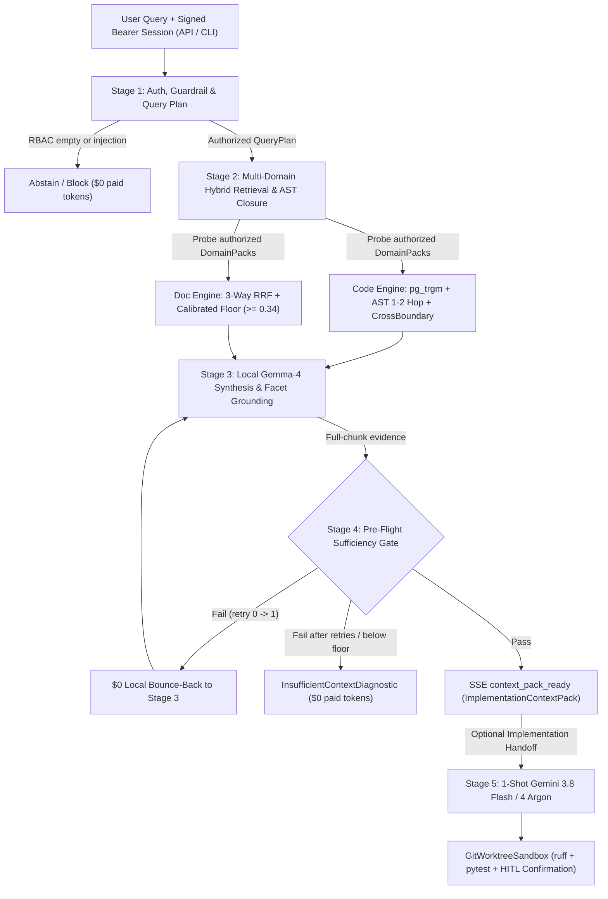
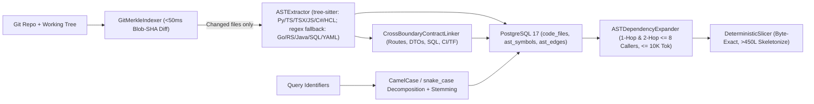

# System Architecture Deep Dive: Dual Retrieval Engines, 4-Stage Pipeline & Inference Topology

This document details the internal architecture of **Enterprise Context Scout**: the 4-stage discovery and verification pipeline, the dual code and document retrieval engines, local Apple Silicon / GPU inference memory management, and the FastAPI SSE + dark-mode React workbench.

---

## 1. End-to-End 4-Stage Pipeline & Optional Stage 5 Handoff

### 1.1 Stage-by-Stage Execution & `StageExecutionTrace` Telemetry

Every query emits structured `StageExecutionTrace` and `StageConfidence` objects (`src/context_scout/schemas/contracts.py`) across both SSE streams and final packs:

1. **Stage 1 — Auth, Guardrail & Query Plan (`Auth, Guardrail & Query Plan`):**
   - **Principal Binding:** Extracts `PrincipalContext` out-of-band (`user_id`, `role`, `allowed_scopes`, `max_session_paid_tokens`) and binds it to PostgreSQL 17 via `RLSConnectionManager` (`SET LOCAL app.principal_scopes`).
   - **Input Guardrail:** Screens the raw query through `PromptInjectionSanitizer` and `SecretRedactor` via `ShieldGemmaGuardrail.evaluate_deterministic_fallback()` (`src/context_scout/security/guardrails.py`). Note: local runtime executes deterministic regex/Unicode/secret rules (`used_fallback=True`) rather than live neural `ShieldGemma 2` weights; novel paraphrased injections rely on SQL `FORCE RLS` and `<untrusted_retrieved_data>` framing.
   - **Structured Query Planning:** Decomposes multi-part queries (`"top N"`, multi-entity comparisons, acronyms) into `query_type`, `core_subject`, `required_facets`, and candidate `target_domains`. Fails closed at `$0` if `allowed_scopes` is empty or an injection payload is detected.
2. **Stage 2 — Multi-Domain Hybrid Retrieval & AST Closure (`Multi-Domain Hybrid Retrieval & AST Closure`):**
   - When `domain_id="federated_all"`, probes all principal-authorized `DomainPack`s in PostgreSQL 17 and records per-domain `DomainProbeTrace` and per-hit `RetrievalHitTrace` telemetry (`cosine_similarity`, `bm25_score`, `trigram_score`, `calibrated_score`, `accepted`, `rejection_reason`).
   - Drops boilerplate/license stubs and hits below `CALIBRATED_RELEVANCE_FLOOR` (`0.34` in `src/context_scout/agents/scout_workflow.py`).
   - Expands code hits with 1-hop and 2-hop `ASTDependencyExpander` edges (`ast_one_hop_count`, `ast_two_hop_count`) and cross-service `CrossBoundaryContractLinker` edges.
3. **Stage 3 — Local Gemma-4 Synthesis & Facet Grounding (`Local Gemma-4 Synthesis & Facet Grounding`):**
   - Feeds **full retrieved chunks** (`verbatim_content`, not 1-sentence snippets) and byte-exact `VerbatimCodeSlice` blocks to local `google/gemma-4-26B-A4B-it` (`AdapterPool` hot-swaps a QLoRA adapter when `lora_enabled: true`, or runs base Gemma-4 when `lora_enabled: false`).
   - Scores cohesive per-facet grounding (`evaluate_facet_grounding`) and emits `sufficiency_verdict` (`"sufficient" | "partial" | "insufficient"`), `grounded_facets`, `total_facets`, and `missing_or_unverified_aspects`.
4. **Stage 4 — Pre-Flight Sufficiency Gate (`Pre-Flight Sufficiency Gate`):**
   - `PreFlightValidator` (`src/context_scout/agents/preflight_gate.py`) executes deterministic checks recorded in `StageExecutionTrace.checks` (`PreFlightCheckLedgerItem`):
     - **Check 1 (Internal Symbol Resolution):** All referenced internal symbols in `code_slices` must resolve in the AST symbol graph.
     - **Check 2 (Target Identifier Grounding):** Target modification symbols must exist in the indexed repository AST.
     - **Check 3 (Retrieval Quality Floor):** Requires `normalized_rrf_score >= 0.65` (`PreFlightValidator.DEFAULT_MIN_RRF_SCORE` / `ScoutSettings.min_retrieval_confidence`) and calibrated retrieval score `>= CALIBRATED_RELEVANCE_FLOOR` (`0.34`), with zero hardcoded API request defaults.
     - **Check 4 (Verbatim Quote Faithfulness):** Every `DocCitationSpan.verbatim_quote` must match the source chunk with `>= 0.98` NFKC + whitespace-normalized token overlap.
     - **Freshness & Scepticism Checks:** Rejects superseded Confluence pages, terminal Jira resolutions (`Won't Fix`, `Duplicate`, etc.), and quant strategies violating statutory friction floors.
   - **Bounce-Back & Abstention:** On failure, bounces structured remediation feedback back to Stage 3 (`max_bounce_backs = 1` local retry turn at `$0`). If still insufficient or ungrounded, emits `InsufficientContextDiagnostic(paid_tokens_spent=0)` and `final_decision="abstain_zero_paid"`.
5. **Optional Stage 5 — Single-Shot Paid Execution & `GitWorktreeSandbox` (`src/context_scout/agents/gemini_executor.py`):**
   - Triggered only on explicit user action (`POST /api/v1/handoff/preview` -> `POST /api/v1/handoff/apply`, or CLI `--handoff-apply`).
   - Sends the verified `ImplementationContextPack` (adaptive `2K–18K` tokens) in 1 shot to `gemini-3.8-flash` (or `gemini-4-argon`), applies patches (`SEARCH/REPLACE` or unified diff) inside an isolated `GitWorktreeSandbox` (`scout-exec-<uuid>`), runs `ruff check` + `pytest`, and pauses at `require_confirmation=True` before merging.

### 1.2 Confidence Calibration (`StageConfidence`)

Each stage computes a `StageConfidence` (`confidence_score` in `[0.0, 1.0]`, `confidence_band`: `"high"` for `>= 0.80`, `"medium"` for `>= 0.55`, `"low"` for `< 0.55`, plus a `signals` breakdown dict):
- **Stage 1:** Reflects guardrail pass, scope count, and facet clarity.
- **Stage 2:** Reflects top calibrated retrieval score, margin over `CALIBRATED_RELEVANCE_FLOOR`, and AST closure completeness.
- **Stage 3:** Reflects `grounded_facets / total_facets` and `sufficiency_verdict`.
- **Stage 4:** Reflects deterministic Pre-Flight ledger pass rate; any failed gate or abstention forces Stage 4 confidence low/blocked so downstream UI never displays false `HIGH` confidence on ungrounded output.

---

## 2. Code Engine (`trading_code_scout`, `polyglot_unseen_v2`)

- **Git Blob-SHA Merkle Sync (`src/context_scout/ingestion/git_merkle_indexer.py`):** Compares `git ls-tree -r HEAD` blob SHAs against `code_files.git_blob_sha` and overlays uncommitted working-tree edits (`M`), untracked files (`??`), and deletions (`D`) via `git --no-optional-locks status --porcelain -unormal` in `<50 ms` (`~22 ms` warm in-memory, `~37.4 ms` live PG17). Supports `isolate_by_commit=True` using `git cat-file -p <commit>:<path>` for historical PR benchmarking without checkout collisions.
- **Polyglot AST & Fallback Extraction (`src/context_scout/ast_engine/extractor.py` & `src/context_scout/plugins/`):** Extracts `function`, `class`, `method`, `interface`, and `type_alias` nodes plus directed edges (`CALLS`, `IMPORTS`, `USES_TYPE`, `INHERITS`, `TESTED_BY`). Full `tree-sitter` grammars (with fail-closed syntax-error diagnostics) cover **Python, TypeScript, TSX, JavaScript/JSX, C# (`tree-sitter-c-sharp`), and Terraform HCL (`tree-sitter-hcl`)**, while **Go, Rust, Java, SQL DDL/RLS, and CI/K8s YAML** currently use lightweight structural regex/block extractors (`low_confidence_fallback=True`).
- **Identifier Word Decomposition & Stemming:** Splits `camelCase` and `snake_case` identifiers into sub-tokens alongside morphological stem expansion so conceptual queries match compound symbol names without dense-vector smearing.
- **1-Hop & 2-Hop `ASTDependencyExpander` (`src/context_scout/ast_engine/dependency_expander.py`):** Configured via `ContextCompletenessConfig` (`src/context_scout/ast_engine/models.py`):
  - `MAX_DIRECT_CALLERS_PER_SYMBOL = 8` diverse callers across distinct files.
  - `MAX_EXPANSION_TOKEN_BUDGET = 10_000` expansion budget and `max_pack_token_budget = 18_000` adaptive pack ceiling.
  - Selective 2-hop `USES_TYPE` / `INHERITS` closure (e.g., tracing an order service method -> SQLAlchemy/DTO model -> foreign-key table schema) via indexed PG17 CTEs (`<1 ms` over `291,090` edges).
- **`CrossBoundaryContractLinker` (`src/context_scout/ast_engine/contract_linker.py`):** Connects backend API routes, frontend TypeScript SDK callers, shared DTO schemas, SQL tables, and Terraform/CI targets across polyglot repositories.
- **Byte-Exact `DeterministicSlicer` (`src/context_scout/ast_engine/deterministic_slicer.py`):** The local model emits `CodeSlicePointer` coordinates only; Python slices UTF-8 bytes verbatim with `git_commit_sha` and `git_blob_sha` provenance, coalesces ascending-line ranges, attaches top-of-file import headers (`L1..last_import_line`), and skeletonizes only classes exceeding `DEFAULT_SKELETONIZE_CLASS_LINE_THRESHOLD = 450` lines (never skeletonizing query-matched methods).

---

## 3. Document Engine (`data_engineering_scout`, `quant_research_scout`)

- **Lossless Multi-Format Parsing (`src/context_scout/ingestion/doc_parser.py`):**
  - `LatexDocParser`: Resolves `\input`/`\include`/`\subfile` includes and keeps display/inline math (`equation`, `align`, `gather`, `multline`, `$$...$$`) and `table`/`tabular` floats intact as atomic chunks while tracking `\section`/`\subsection` breadcrumbs.
  - `PdfDocParser`: `pypdf` extraction with NUL-byte sanitization and section heading detection.
  - `MarkdownTableChunker` & Markup Strippers: Preserves GitHub-flavored Markdown tables with fenced code-block guards, plus clean parsing for `.md`, `.mdx`, `.adoc`, `.sgml`, `.rst`, `.html`, `.json`, and `.csv`.
- **Contextual Headers (`src/context_scout/ingestion/contextualizer.py`):** Supports an optional HTTP `google/gemma-4-E4B-it` 50-token header client, while the indexed local PostgreSQL 17 corpora (`31,704` DE + `14,188` Quant chunks) use `DeterministicContextualizer` section/metadata breadcrumbs before 768-d embedding.
- **3-Way Hybrid RRF (`src/context_scout/db/repositories.py`, `bm25.py`):** Fuses 768-dim `google/embeddinggemma-2` cosine similarity (`embedding <=> %s::vector`), PostgreSQL `tsvector` BM25 (`websearch_to_tsquery` + `ts_rank_cd`), and `pg_trgm` (`word_similarity`) weighted by `authority_weight`, `market_scope`, and `doc_title`, normalized to `[0.0, 1.0]` (`k = 60`).
- **Calibrated Relevance Filtering:** `CALIBRATED_RELEVANCE_FLOOR = 0.34` filters weak cosine/BM25 noise before Stage 3 synthesis; license headers and boilerplate chunks (`is_license_or_stub_text`) are rejected deterministically.
- **Confluence Version Supersession & `ConflictDetector` (`src/context_scout/agents/conflict_detector.py`):** Enforces monotonic `version_number` supersession (older versions marked `is_stale=True` with `superseded_by` links) and flags contradictions between current code/AST implementations and stale RFCs or deprecated wiki pages.
- **Market-Regime Quant Scepticism Gate (`src/context_scout/ingestion/scepticism_gate.py`):** Flags `QuantStrategyBrief` outputs whose transaction cost assumptions fall below statutory market floors (`>= 15.0 bps` `IN_NSE` delivery, `>= 5.0 bps` `IN_NSE` intraday/futures, `>= 10.0 bps` `DE_XETRA`, `>= 5.0 bps` `US_EQUITY`), net Sharpe `<= 0.50`, or max drawdown `> 30.0%`.

---

## 4. Local Inference & Memory Architecture

- **Primary Local Model:** `mlx-community/gemma-4-26b-a4b-it-4bit` (`google/gemma-4-26B-A4B-it`), a sparse Mixture-of-Experts model with **25.2B total / 3.8B active parameters** per token (`~17.1 GB` 4-bit footprint, streaming `~2.2 GB` active weights per token).
- **Single-Slot GPU Cache & POSIX Lock (`src/context_scout/agents/scout_workflow.py`):**
  - `MAX_LOADED_MLX_MODELS = 1` enforces a process-shared single-slot `OrderedDict` cache (`_PROCESS_MLX_CACHE`) with `mlx.core.clear_cache()` on eviction, preventing 15 GB+ Metal weight duplication across concurrent requests.
  - `detect_hardware_profile()` (`src/context_scout/config.py`) clamps `--max-kv-size` dynamically (`8,192` for `<24 GB`, `16,384` for `24–35 GB`, `32,768` for `>= 36 GB` such as a 48 GB Apple M5 Pro).
  - `/tmp/context_scout_gpu.lock` serializes GPU access between inference and QLoRA training.
- **Metal Race Prevention (`src/context_scout/retrieval/embedder.py`):** `SCOUT_EMBEDDING_DEVICE=cpu` pins PyTorch `google/embeddinggemma-2` (768-d) to CPU when running alongside MLX Metal inference so concurrent Metal command buffers never contend.
- **`AdapterPool` & `lora_enabled` Policy (`src/context_scout/agents/domain_registry.py`):**
  - Pins rank-16 QLoRA adapters (`~9.97 MB`, 54 tensors, MoE `router.proj` gates frozen) in memory for `0.018 ms` pointer switching.
  - **Code pointer domains** (`trading_code_scout`, `polyglot_unseen_v2`) set `lora_enabled: true` to enforce compact `CodeSlicePointer` JSON emission.
  - **Prose research domains** (`data_engineering_scout`, `quant_research_scout`) set `lora_enabled: false` to run base `Gemma-4-26B-A4B-it` over full retrieved `verbatim_content` chunks without adapter JSON-looping.

---

## 5. FastAPI SSE Backend & Dark React Workbench (`web-ui/`)

- **`GET /api/v1/workspace-config` (`src/context_scout/api/routes/workspace.py`):** Dynamically returns all registered `DomainPack`s, live PostgreSQL 17 RLS document/symbol counts per domain, `federated_all` auto-route metadata, role presets (`DEFAULT_ROLE_SCOPES`), and the 4 `PipelineStageSpec` definitions.
- **`POST /api/v1/auth/session` & `GET /api/v1/auth/me` (`src/context_scout/api/routes/auth.py`):** Mints short-lived (`3600s`) HMAC-SHA256 Bearer tokens bound to `PrincipalContext` in non-production environments (returns `HTTP 403` when `is_production_environment()` is true).
- **`POST /api/v1/scout/stream` (`src/context_scout/api/routes/scout.py`):** Streams typed Server-Sent Events:
  - `stage_update`: Emits per-stage `StageConfidence` and expandable `StageExecutionTrace` telemetry (query plan, domain probe scores, AST hop counts, chunks fed, Pre-Flight ledger).
  - `bounce_back`: Emits `$0` local retry diagnostics when Stage 4 returns feedback to Stage 3.
  - `context_pack_ready`: Delivers the final `ImplementationContextPack` (answer synthesis, byte-exact `code_slices`, `research_citations`, `query_facets`, `missing_or_unverified_aspects`, or `$0` abstention diagnostic).
  - `error`: Emits structured guardrail, auth, or runtime errors.
- **`GET /api/v1/health` (`src/context_scout/api/routes/health.py`):** Probes live PostgreSQL 17 connectivity, `AdapterPool` integrity, `lora_enabled` slot count, host CPU/memory hardware profile, and active runtime mode.
- **Dark React Workbench (`web-ui/`):** Strict TypeScript (`"strict": true`, zero `any`) dark-mode UI (`#0B0E14` / `#111620`) driven entirely by `/api/v1/workspace-config` and `/api/v1/scout/stream`—no mock stream fallbacks in production components.
